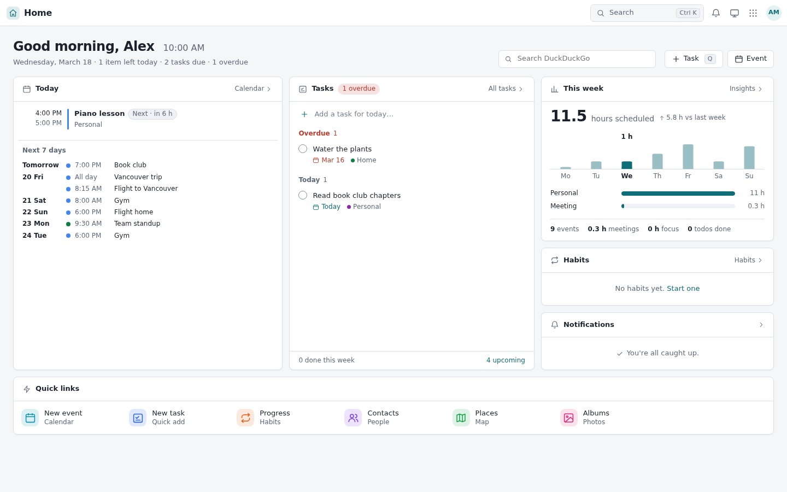
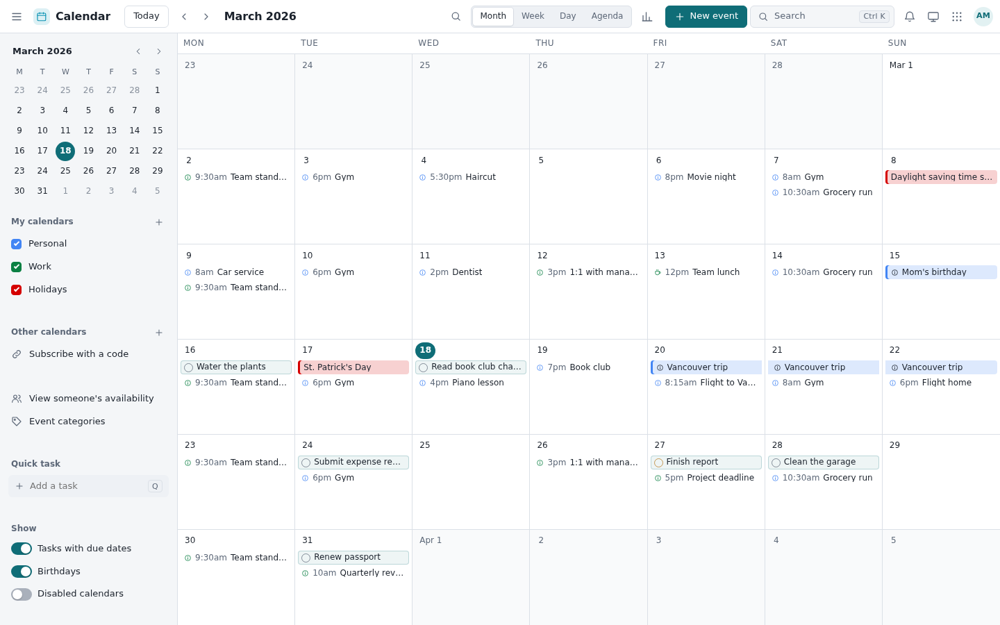
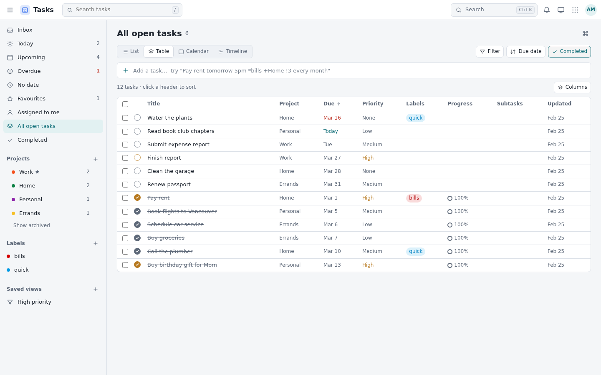
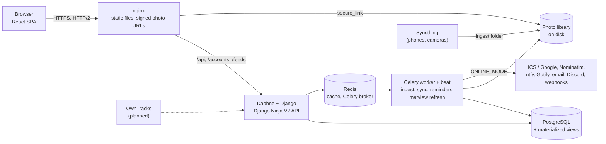

<div align="center">

# AVNet Superapp

**A self-hosted Google Workspace for one family: calendar, tasks, habits, contacts, photos, places and notifications on one server, with one typed API.**

<!-- Badges: placeholders until CI and a licence exist -->


<picture>
  <source media="(prefers-color-scheme: dark)" srcset="docs/screenshots/home-dark-desktop.png">
  
</picture>

</div>

> Code name **Comptech**: the Django project, database, scripts and module names still use it. Only the visible product is called AVNet Superapp. [Why "Comptech"?](#why-comptech)

## What it is

AVNet Superapp is one web app with nine apps inside, sharing one account, one design system (light and dark), one notification system and one JSON API. It's built for a **family or a small business** of a few to a few dozen people, on a server you own. It is not an enterprise suite and doesn't try to be.

The apps know about each other. Calendar days show the photos you took and your contacts' birthdays. An event turns into a task in one click. Places lists the photos taken nearby. Reminders from every app arrive through the channels you choose.

### Provenance

This isn't a weekend AI build with back-dated commits. It has run in production for a family since 2021, and the code shows it: decade-old naming decisions, 70+ schema migrations, data migrations written around real messy data, two recoveries from backups, and quirks that only exist because real people used it every day. Think of the history as proof of age on an art piece: [the full story](docs/HISTORY.md), and [why things look the way they do](#quirks-or-why-is-it-like-this).

## Apps

| | App | Standout features |
|---|---|---|
|  | **Home** | Today's agenda, open tasks, habits due, unread notifications, a "this week" time breakdown and quick links, each card loading only when visible. |
|  | **Calendar** | Month, week, day and agenda views; shared calendars with roles and invite codes; ICS and Google sync; private events shown to others as "Busy"; availability; a second time zone; Insights (where your time went, by category, weekday and hour). |
|  | **Tasks** | Nested projects with list, board (WIP limits), table, calendar and Gantt timeline views; natural-language quick add (`Pay rent tomorrow 5pm *bills !3 every month`); repeating tasks, reminders, relations, bulk edits and sharing. Smooth at 5,000 tasks. |
|  | **Habits** | Yes/no and measurable habits with daily, weekly or monthly goals, schedules, streaks, a Loop-style score, a backfill grid and a year heat map. |
|  | **Contacts** | A personal CRM: vCard, Google, Outlook and LinkedIn imports, duplicate merging, an interaction log, keep-in-touch and birthday reminders. |
|  | **Photos** | A justified timeline over hundreds of thousands of photos and videos; libraries and shared albums; RAW and originals; smart search (`dog toronto 2019`, `pixel 7 paris june 2023`) over places, cameras, dates and detected objects; map and heat map; stats, storage and superlatives; hidden photos; a Geoguessr game built from your own photos. |
|  | **Places** | Saved places in groups, photos taken nearby with visit history, places suggested from photo GPS, want-to-go and visited lists, and GeoJSON, Takeout and KML import and export. |
|  | **Notifications** | An inbox and bell menu, delivery to ntfy, Gotify, email, Discord or any webhook (e.g. Home Assistant), and automatic reminders for events, deadlines, tasks, habits, birthdays and a morning agenda. |
|  | **Settings** | Profile, appearance and keyboard shortcuts; per-app API keys; private ICS feeds for phone calendar apps; API guides; and, for staff, a privacy-respecting usage dashboard. |

Everything works on a phone too: sidebars become drawers and toolbars compact.

| Phone, light | Phone, dark | Phone, dark |
|---|---|---|
|  |  |  |

<sub>Screenshots are taken with Playwright against randomly generated data, in light and dark, desktop and phone: `docs/screenshots/<app>-<light|dark>-<desktop|phone>.png`.</sub>

## Across the apps

- **Integrations:** photo counts on calendar days, birthdays from Contacts in Calendar, tasks from events, photos near a place and places from photo GPS, photos taken in Calendar Insights, and reminders from every app through one notification service.
- **Privacy:** hidden photos are invisible to everyone, and their owner can reveal them only in a session-only mode that switches off after 30 minutes. Other people's private events show as "Busy" in feeds, tasks and insights. Usage analytics keeps only daily counts per person and app (no URLs, IPs or browser details).
- **No surprise network calls:** outbound requests (calendar sync, map search, push channels) are gated by `ONLINE_MODE`. With it off, the server talks only to LAN addresses. Third-party JS and CSS are bundled or pinned by SHA-256, never loaded from a CDN.
- **Built to be built on:** a typed V2 API for every app, per-app API keys and Markdown guides written for developers and AI agents (see [API](#api)).
- **Keyboard first:** a Ctrl-K command palette, `G` then a letter to jump between apps, and per-app shortcuts.

## Is it for you? Read this first

This is an **opinionated** project, shaped by one family's daily use.

- **Photos is for a fairly pro user.** It keeps RAW files and originals, separates camera *libraries* from shared *albums*, reports storage, and has tools for fixing locations. It doesn't make per-photo previews or edits: it was designed around a large library on a small disk.
- **Calendar sync is archival, not two-way.** It imports ICS and Google calendars and keeps their history, the way you'd want for a personal record. It doesn't push changes back like an enterprise groupware server.
- **Other choices you inherit:** one React interface, self-hosted only, `ONLINE_MODE` off by default for outbound calls, a lean trust model (apps run in one trusted process), and API keys scoped per app.

### Limitations

- **No native mobile app.** The web app works well on phones; location history through the OwnTracks app is planned, not built.
- **Photo ingest is folder-based.** Files are expected to land in the Ingest folder, e.g. synced from phones with Syncthing. There's no automatic phone backup client like Google Photos has.
- **One server.** No clustering or high availability.
- **No end-to-end encryption.** Whoever runs the server can read the data.
- **English only**, no translations.
- **Postgres in production.** SQLite works for local testing only.
- **Object detection is optional and heavy** (ultralytics/PyTorch, runs after each ingest).

## Inspirations

- **Google Workspace (G Suite)** for the breadth of apps and how well they work together, and for the look: compact toolbars, dense but calm pages.
- **Nextcloud** is the obvious self-hosted comparison. I don't use it because it's built for organisations: admin consoles, groupware, enterprise sync. My use case is a family, and I wanted apps that fit how we actually live, connected the way we want.

## Origins

Parts of this code were first written in **2020**, in high school, long before AI coding tools: a school task scheduler called Docket and a YMCA group calendar, whose `calendar.js` became Comptech's first calendar. Comptech's first commit was in February 2021, and it has **run in production in some form for over five years**, through four calendar rewrites, an SSD failure and a recovered backup.

The whole story, with commit hashes, is in **[docs/HISTORY.md](docs/HISTORY.md)**, *My Very Own Tech Giant*: a homework planner that grew into a superapp, the apps that didn't make it, and the commit-message hall of fame.

### Why "Comptech"?

When I was about 12, I wanted to build my own tech company. "Comptech", short for *Computer Technology*, was the best name 12-year-old me could come up with (I'm still not great at names, as my other repos will show). In 2020, when 15-year-old me set out to build "my own private tech-giant-scale platform", it was the first name that came to mind, and it stuck: it's in the package, the database and too many other places to be worth changing now.

It's also a little poetic. A decade later, I've finally made 12-year-old me proud: a project built entirely on my own, at a scale that borrows its ambition from the tech giants I looked up to back then, and now open source. Let it stand as a hopeful beacon that one day there will be a company of my own behind the name too. (I'll update this README when that happens.)

### How AI was (and wasn't) used

- **2020 to early 2025: no AI.** Everything up to the SSD failure was hand-written.
- **From the 2025 backup restore: Cursor, Windsurf and Google Antigravity**, three different tools, each used to some degree. The restored code was behind the spec I had already built and lost with the failed SSD, so AI helped bring it back up to that spec fast, and then sped up bug fixes and features.
- **From November 2026: Claude Code.**

In November 2026 V1 was overhauled end to end with **Claude Code**: critical security fixes, the V2 API, Tasks, Habits, Contacts, notifications, a single design system with dark mode, a new React interface and the performance work below.

AI wrote much of that code, but **every change was reviewed, tested and used in production by a real human** (me): deployed to the real server, rehearsed on a copy of the real database first, and fixed from bugs reported back from daily family use. That's more human review than the average SF AI startup.

## Performance

Speed comes first here, after security and usability. Measured on the production-sized library (~300k photos):

| What | Before | After | How |
|---|---:|---:|---|
| Photos timeline page | 162 ms | **23 ms** | `(date_taken, id)` index; in the database alone 152 → 4 ms |
| Photos near a place | 86 ms | **14 ms** | latitude/longitude index |
| Photo stats | ~1.2 s | **~60 ms** | Redis per-user cache, cleared by a generation counter that any photo change bumps |
| Page show after navigation | ~380 ms | **~100 ms** | route-level code splitting and data prefetch |
| Selecting a photo | 141 ms | **15 ms** | only the changed tiles re-render |
| Tasks list, 5,000 tasks | 409 KB, 949 ms to first rows | **85 KB, 353 ms** | keyset paging and windowed rows |
| Cold Photos load | 744 KB | **227 KB** | precompressed (`gzip_static`) bundles |

Also under the hood:

- **Materialized views:** a per-day photo rollup (badges, stats, storage) and a heat-map location cache, both refreshed `CONCURRENTLY` and coalesced through Celery so a burst of edits causes one refresh.
- **Cursor (keyset) paging** everywhere lists can be long: stable while data changes.
- **A database connection pool**, gzip and ETag/304 on API responses, content-hashed static files cached as `immutable`, and HTTP/2.
- **Few, deduplicated requests:** TanStack Query caching, and pages that keep showing data on errors instead of going blank.

Fun fact: the entire repository, with nearly six years of history, is about **5 MB**: smaller than a single photo it stores.

## Architecture



- **One React app at `/`**, built on the V2 API only. nginx serves its hashed bundles and checks signed `secure_link` URLs for photos and private files, so image bytes never pass through Python.
- **Django** (under Daphne) serves the API, login, ICS feeds and admin. Each app (`scheduler`, `tasks`, `habits`, `contacts`, `photos`, `map`, `notifications`, …) is a Django app with its own models and API router.
- **Celery** handles everything slow or scheduled: photo ingest and AI indexing, calendar auto-sync every 30 minutes, reminders, clean-ups and matview refreshes. Beat registers its own schedules.

### Tech stack

| Layer | Tools |
|---|---|
| Backend | Python, Django 5.1, Django Ninja (V2 API), Channels + Daphne, Celery + django-celery-beat |
| Data | PostgreSQL (psycopg 3 pool, materialized views), Redis (cache, broker, channels) |
| Photos | Pillow, OpenCV, ExifRead/PyExifTool/piexif, offline reverse geocoding, ultralytics YOLO (optional) |
| Calendar | icalendar, python-dateutil (RRULE), dateparser |
| Frontend | React 19, React Router 7, TanStack Query 5, TypeScript, Vite 7, Leaflet; no UI kit, no chart library |
| Serving | nginx (HTTP/2, `gzip_static`, `secure_link`), WhiteNoise for local runs |

## API

Every app has a typed JSON API at `/api/v2/`, with interactive docs at `/api/v2/docs` and the schema at `/api/v2/openapi.json`.

- **Per-app API keys** from **Settings → API keys**: read or write per app, optional expiry, shown once and stored hashed. Send `Authorization: Bearer avn_...`.
- **Guides for developers and AI agents** at `/api/v2/<app>/guide.md`: concepts, every endpoint and its JSON schema, generated from the live schema so they never drift. Point an agent at a guide and a key, and it can work with your tasks or calendar.
- ISO 8601 datetimes with offsets, UUID ids, errors as `{"detail": ...}`, 600 requests per minute per key.

```bash
curl -H "Authorization: Bearer $KEY" https://app.example.com/api/v2/tasks/?view=today
curl -X POST -H "Authorization: Bearer $KEY" -H "Content-Type: application/json" \
     -d '{"text": "Pay rent tomorrow 5pm *bills !3 every month"}' https://app.example.com/api/v2/tasks/quick
```

## Try it locally

One command sets up a self-contained copy with SQLite, no Redis, no nginx and Celery tasks running inline, filled with dummy users, calendars, tasks and places. Details: [localdev/README.md](localdev/README.md).

```bash
localdev/setup.sh [--photos]      # venv, secrets, SQLite DB and dummy data (plus sample photos)
frontend/build.sh                 # builds the React app (Node 20.19+, 22 recommended)
localdev/run.sh                   # http://127.0.0.1:8000  (login: amol / localdev; also alex, sam)
```

Run the tests with `DJANGO_SETTINGS_MODULE=Comptech.settings_local .venv/bin/python manage.py test` and, in `frontend/`, `npm test`. For hot-reloading frontend work, see [frontend/README.md](frontend/README.md).

## Self-hosting

Production runs Postgres, Redis, Daphne, a Celery worker and Celery beat behind nginx, on one Linux server. Site-specific values (URL, hostnames, email sender) live in an untracked `Comptech/site.json`, and secrets in untracked files.

- [docs/UPGRADE-phase-1.md](docs/UPGRADE-phase-1.md): the full upgrade guide, with a rehearsal on a copy of production, every command and a rollback plan.
- [docs/UPGRADE-fix-critical-bugs.md](docs/UPGRADE-fix-critical-bugs.md): the earlier security-fix upgrade.
- [`nginx.conf`](nginx.conf): a template with the caching, HTTP/2 and signed-URL rules.

Ground rules if you contribute: no CDNs (vendor files are pinned in `static_files/vendor.lock`), no new outbound services without a switch behind `ONLINE_MODE`, and never commit secrets.

## Roadmap

V1 is being kept fast, safe and pleasant until its successor is ready. **Everything below is planned, not built.**

- **V2, "Memex":** a modular rewrite, planned separately. Its centrepiece is much better local photo search: faces grouped into people and linked to contacts, plain-language search and text found inside photos, plus search across apps.
- **New apps:** location history (ported from my Atlas project, with OwnTracks), a journal, finances and health.

## Documentation

| Doc | What's in it |
|---|---|
| [docs/HISTORY.md](docs/HISTORY.md) | The history of the project, 2020 to 2026 |
| [docs/README.md](docs/README.md) | Technical docs: calendar and photos data models and pipelines |
| [docs/UPGRADE-phase-1.md](docs/UPGRADE-phase-1.md) | Production upgrade guide |
| [localdev/README.md](localdev/README.md) | Local setup and how it differs from the server |
| [frontend/README.md](frontend/README.md) | The React app: layout, development, build and deploy |
| `/api/v2/docs`, `/api/v2/<app>/guide.md` | Live API reference and agent guides (on a running server) |

## Quirks (or: why is it like this?)

Six years of history leave fingerprints, and some go back further: a name picked at 12 still runs through the package, the database and the deploy scripts. It's the software version of the old story that the Space Shuttle's boosters were sized by the width of two horses, by way of railway gauges and Roman chariots. That story is [mostly a myth](https://signoregalilei.com/2025/11/08/were-the-space-shuttles-boosters-really-the-size-of-two-horse-butts), but here it's true: decisions from a decade ago still shape this code. If something looks odd, it probably has a story:

- **The calendar app is called `scheduler`.** In 2020, `calendar` clashed with Python's own `calendar` module, so it got another name, and the name stuck.
- **Tasks live in `scheduler.Todo`, not in the `tasks` app.** The Tasks app was built around the existing table so old data, the calendar and Home keep seeing the same todos.
- **Places is the `map` app.** Its models are still `LocationGroup` and `Location`.
- **Photos' `Album` is a library** (a camera folder on disk); a shared album is a `ShareAlbum`. Naming is hard, renaming a database is harder.
- **The Photos static folder is `photos/static/photo/`**, singular, because why not.
- **Everything is `Comptech`:** the project package, `ComptechUser`, the database and `Comptech.sh`. Only the visible product is AVNet Superapp.
- **Task priority runs 0 to 20** (None, Low, Medium, High, Urgent in steps of 5), leaving room in between that nobody has used yet.
- **Calendar categories were once numbers** (0–9 and 100). They're named per-owner categories now, and each remembers its old number in `legacy_id`.
- **`date_taken` is the camera's wall clock**, stored as if it were in the server's time zone, because EXIF rarely says where you were.

## Credits

**Amol Venkataraman** has been the only developer on this project in any real sense, from the first line in 2020 to today. Family and friends contributed ideas, suggestions and the occasional fix, and AI tools have helped recently, but the design, code, review and six years of running it in production are mine. Most of my projects at this scale have been group projects; this is the biggest, coolest and most ambitious thing I've built solo.

AI coding tools (assistants, not contributors):

- **Cursor, Windsurf and Google Antigravity** (AI editors): helped restore the lost spec after the 2025 backup restore, then sped up bug fixes and features.
- **Claude Code** (AI): pair programmer for the November 2026 overhaul, with every change reviewed by me.

## Licence

TBD.
