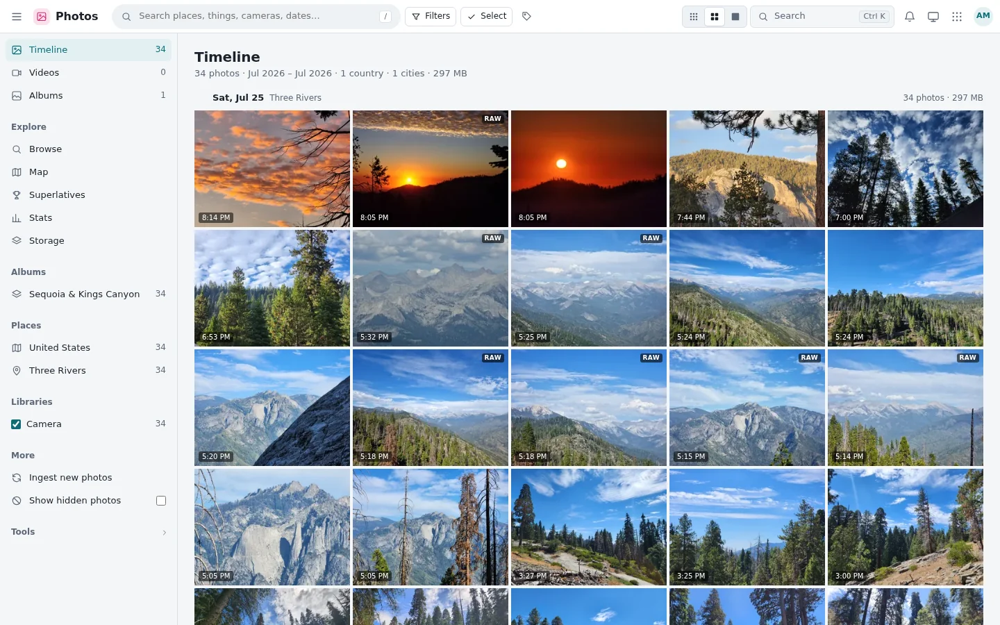
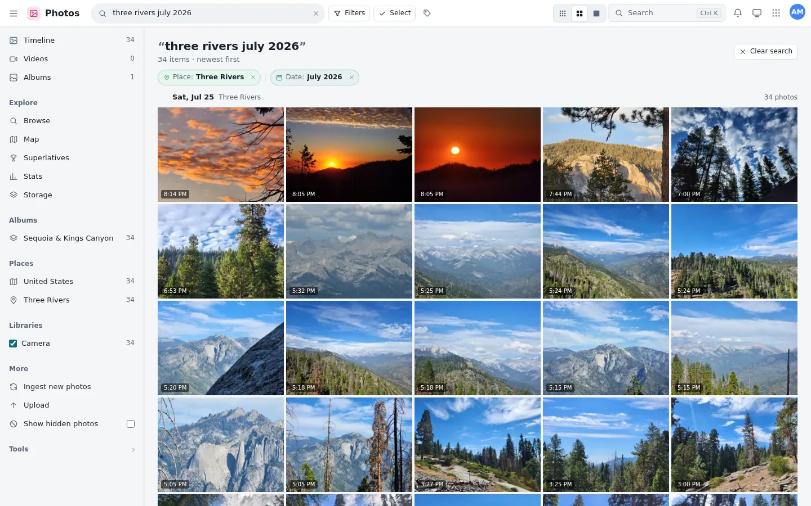
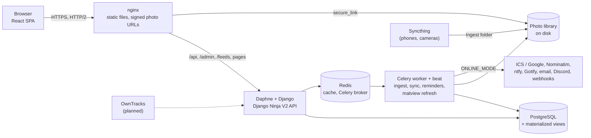

<div align="center">

# AVNet Superapp

**A self-hosted life management and logging platform.**<br>
Calendar, tasks, habits, contacts, photos, places and notifications for a family, on a server you own, with ideas (and a lot of functionality) borrowed from Google Workspace apps.

<!-- Badges: CI is a placeholder until a workflow exists -->

[](LICENSE)


</div>

> Inside the code it's still called **Comptech**: the Django project, the database and every module use the name I picked at 12. Only the name you see changed. [Why "Comptech"?](#why-comptech)

## What it is

It started in 2020 as a calendar for my school deadlines, and it kept growing every time my family needed something new. Six years later it's nine apps in one: a calendar, a task manager, a habit tracker, a personal CRM, a photo library that handles hundreds of thousands of photos, a map of the places we've been, and one notification system tying it all together.

It does two jobs. It helps you plan your days, and it quietly keeps the record of them: what you did, where you went, who you kept in touch with, and what you photographed along the way.

The part I care about most is that **the apps know about each other.** Open a day in the calendar and you see the photos you took that day and whose birthday it is. Turn an event into a task in one click. Open a place and see every photo you've taken nearby and when you were last there. Reminders from every app arrive in one inbox, on whichever channel you like.

It's built for **a family or a small business**, a few people to a few dozen, on hardware you control. It isn't an enterprise suite and doesn't want to be.

### Provenance (or: this is not a weekend AI project)

This has been running in production for my family since 2021, and the code has the scars to prove it: naming decisions I made as a teenager, 70+ schema migrations, data migrations written around years of real, messy data, two recoveries from backups, and quirks that only exist because real people used it every single day.

That history is the point. Think of it as proof of age on an art piece: here's [the full story](docs/HISTORY.md), and here's [why things look the way they do](#quirks-or-why-is-it-like-this).

## Apps

| App | What it does |
|---|---|
| **Home** | Your day at a glance: today's agenda, open tasks, habits due, unread notifications, where your week went, and quick links. Each card loads only when you scroll to it. |
| **Calendar** | Month, week, day and agenda views. Shared calendars with roles and invite codes, ICS and Google sync, private events that others only see as "Busy", availability, a second time zone, and Insights that show where your time actually went (by category, weekday and hour). |
| **Tasks** | Nested projects with list, board (with WIP limits), table, calendar and Gantt views. Quick add understands plain language (`Pay rent tomorrow 5pm *bills !3 every month`). Repeating tasks, reminders, relations, bulk edits and sharing, and it stays smooth at 5,000 tasks. |
| **Habits** | Yes/no or measurable habits with daily, weekly or monthly goals, schedules, streaks, a Loop-style score, a grid for filling in days you missed, and a year heat map. |
| **Contacts** | A personal CRM: import from vCard, Google, Outlook or LinkedIn, merge duplicates, log interactions, and get nudged to keep in touch and to not forget birthdays. |
| **Photos** | A justified timeline over hundreds of thousands of photos and videos. Camera libraries and shared albums, RAW files and originals, and smart search that reads `dog toronto 2019` or `pixel 7 paris june 2023` as objects, places, cameras and dates. Plus a map and heat map, stats, storage, superlatives, hidden photos, and a Geoguessr-style game built from your own pictures. |
| **Places** | Your saved places in groups, the photos you took near each one and when you visited, places suggested from photo GPS, want-to-go and visited lists, and GeoJSON, Google Takeout and KML import and export. |
| **Notifications** | An inbox and a bell menu, delivery to ntfy, Gotify, email, Discord or any webhook (Home Assistant, for example), and automatic reminders for events, deadlines, tasks, habits, birthdays and a morning agenda. |
| **Settings** | Profile, appearance and keyboard shortcuts, per-app API keys, private ICS feeds for your phone's calendar app, API guides, and, for staff, a usage dashboard that respects privacy. |

| Calendar | Tasks |
|---|---|
|  |  |
| **Photos** | **Photos smart search** |
|  |  |

<sub>All screenshots show fictional data (a made-up user, Alex Morgan, and 34 photos from one day in Sequoia National Park), rendered from the app's own build with mocked API responses. **[More screenshots](docs/SCREENSHOTS.md)**, and **[every app through the years](docs/SCREENSHOTS-HISTORY.md)**.</sub>

It all works on a phone too: sidebars turn into drawers and toolbars tuck themselves away.

## Across the apps

- **Everything connected:** photo counts on calendar days, birthdays from Contacts in the calendar, tasks made from events, photos near a place, places found from photo GPS, the photos you took in Calendar Insights, and reminders from every app through one notification service.
- **Private by default:** hidden photos are invisible to everyone. Even their owner can only reveal them in a session-only mode that switches itself off after 30 minutes. Other people's private events show as "Busy" everywhere: feeds, tasks and insights. Usage analytics keeps only daily counts per person and app (no URLs, IPs or browser details).
- **No surprise network calls:** anything that talks to the internet (calendar sync, map search, push channels) sits behind `ONLINE_MODE`. With it off, the server only talks to your LAN. Third-party JS and CSS are bundled or pinned by SHA-256, and nothing loads from a CDN.
- **Made to be built on:** a typed V2 API for every app, per-app API keys, and Markdown guides written for both developers and AI agents (see [API](#api)).
- **Keyboard first:** a Ctrl-K command palette, `G` then a letter to jump between apps, and shortcuts in every app.

## Is it for you? Read this first

This is an **opinionated** project. It was shaped around how one family actually lives, so some choices will feel odd if you expect something else.

- **Photos is for people who care about their files.** It keeps RAW files and originals, separates camera *libraries* from shared *albums*, tells you exactly where your storage goes, and has tools for fixing locations. It never makes its own per-photo previews or edits, because it was designed around a huge library on a small disk.
- **Calendar sync is for keeping a record, not two-way sync.** It imports ICS and Google calendars and keeps their history, the way you'd want for a personal archive. It doesn't push changes back the way an enterprise groupware server would.
- **Self-hosted, and built to fail gracefully.** It assumes you run it on your own hardware, and every part is designed so that when something breaks, the damage stays small and recoverable. Photos are plain files in folders on your disk, not objects in something like MinIO, so your library stays yours, readable and backed up, even if the app dies. The caches, summary tables and Redis can all vanish without losing a thing. The honest origin of this: 15-year-old me didn't trust my own code. The code (and my trust in it) has come a long way since, but the principle stuck. More in my [build philosophy](https://amolven.com/build-philosophy).
- **Other choices you inherit:** one React interface, self-hosted only, `ONLINE_MODE` off by default, a lean trust model (all apps run in one trusted process), and API keys scoped per app.

### Limitations

Things that may come later (no promises, but PRs are welcome):

- **No native mobile app yet.** The web app works well on phones. Location history through the OwnTracks app is planned but not built.
- **Photo ingest is folder-based.** New files are expected to land in an Ingest folder, for example synced from your phone with Syncthing. There's no automatic phone backup like Google Photos has, though other ingest methods may come.

Things that aren't planned, because they add too much overhead for a family or small-business server:

- **One server.** No clustering or high availability.
- **English only.** No translations.
- **No end-to-end encryption**, and it will most likely never be added. You run the server, so whoever runs it can read the data. That's the whole model.

Also worth knowing:

- **Postgres in production.** SQLite is only for local testing.
- **Object detection is optional and heavy.** It uses ultralytics/PyTorch and runs after each ingest.

## Inspirations

- **Google Workspace (G Suite):** the range of apps, how well they work together, and the look: compact toolbars and pages that are dense but calm. A lot of the functionality here started as "I like how Google does this, but I want it on my own server, connected my way."
- **Nextcloud** is the obvious self-hosted comparison. I don't use it because it's built for organisations: admin consoles, groupware, enterprise sync. I needed something for a family, with apps that fit how we actually live.

## Origins

Parts of this code go back to **2020**, written in high school, long before AI coding tools existed. When COVID moved school online, my classes ended up split across two platforms that didn't talk to each other, Google Classroom and Brightspace. So I built **Docket**: one calendar where students could find all their deadlines, assignments and exam dates in one place. Docket's `calendar.js` became Comptech's first calendar, and Docket slowly grew into today's Calendar app.

Comptech's first commit landed in February 2021, and it has **run in production in some form for over five years**, through four calendar rewrites, an SSD failure and a backup restore.

The whole story, with commit hashes, is in **[docs/HISTORY.md](docs/HISTORY.md)**, *My Very Own Tech Giant*: how a homework planner turned into a life management and logging platform, the apps that didn't make it, and the commit-message hall of fame. Screenshots of every version are in **[docs/SCREENSHOTS-HISTORY.md](docs/SCREENSHOTS-HISTORY.md)**.

### Why "Comptech"?

When I was about 12, I wanted to start my own tech company. "Comptech", short for *Computer Technology*, was the best name 12-year-old me could come up with (I'm still not great at names, as my other repos will show). In 2020, when 15-year-old me set out to build "my own private tech-giant-scale platform", it was the first name that came to mind, and it stuck. It's in the package, the database and far too many other places to be worth changing now.

It's also a little poetic. A decade later, I think I've finally made 12-year-old me proud: a project built entirely on my own, borrowing its ambition from the tech giants I looked up to back then, and now open source. Let it stand as a hopeful beacon that one day there'll be a real company behind the name too. (I'll update this README when that happens.)

### How AI was (and wasn't) used

- **2020 to early 2025: no AI at all.** Everything up to the SSD failure was written by hand.
- **After the 2025 backup restore: Cursor, Windsurf and Google Antigravity**, three different tools, each used to some degree. The restored code was behind the version I'd already built and lost with the SSD, so AI helped me get it back to that point fast, and then sped up bug fixes and new features.
- **From November 2026: Claude Code.** I used it to overhaul V1 end to end: security hardening (key handling, host checks, permissions), the V2 API, Tasks, Habits, Contacts, notifications, one design system with dark mode, the new React interface, and the performance work below.

AI wrote a lot of that code, but **every change was reviewed, tested and used in production by a real human** (me). It was deployed to the real server, rehearsed on a copy of the real database first, and fixed from bugs my family hit in daily use. That's more human review than the average SF AI startup.

## Performance

Speed comes first here, after security and usability. Measured on the production-sized library (~300k photos):

| What | Before | After | How |
|---|---:|---:|---|
| Photos timeline page | 162 ms | **23 ms** | `(date_taken, id)` index; in the database alone 152 → 4 ms |
| Photos near a place | 86 ms | **14 ms** | latitude/longitude index |
| Photo stats | ~1.2 s | **~60 ms** | Redis per-user cache, cleared by a generation counter that any photo change bumps |
| Page show after navigation | ~380 ms | **~100 ms** | route-level code splitting and data prefetch |
| Selecting a photo | 141 ms | **15 ms** | only the changed tiles re-render |
| Tasks list, 5,000 tasks | 409 KB, 949 ms to first rows | **85 KB, 353 ms** | keyset paging and windowed rows |
| Cold Photos load | 744 KB | **227 KB** | precompressed (`gzip_static`) bundles |

Also under the hood:

- **Materialized views:** a per-day photo rollup (badges, stats, storage) and a heat-map location cache, both refreshed `CONCURRENTLY` and coalesced through Celery so a burst of edits causes one refresh.
- **Cursor (keyset) paging** everywhere lists can be long: stable while data changes.
- **A database connection pool**, gzip and ETag/304 on API responses, content-hashed static files cached as `immutable`, and HTTP/2.
- **Few, deduplicated requests:** TanStack Query caching, and pages that keep showing data on errors instead of going blank.

Fun fact: the code, with nearly six years of history, is about **5 MB**: smaller than a single photo it stores.

## Architecture



- **One React app at `/`**, built on the V2 API only. nginx serves its hashed bundles and checks signed `secure_link` URLs for photos and private files, so image bytes never pass through Python.
- **Django** (under Daphne) serves the API, login, ICS feeds and admin. Each app (`scheduler`, `tasks`, `habits`, `contacts`, `photos`, `map`, `notifications`, …) is a Django app with its own models and API router.
- **Celery** handles everything slow or scheduled: photo ingest and AI indexing, calendar auto-sync every 30 minutes, reminders, clean-ups and matview refreshes. Beat registers its own schedules.

### Tech stack

| Layer | Tools |
|---|---|
| Backend | Python, Django 5.1, Django Ninja (V2 API), Channels + Daphne, Celery + django-celery-beat |
| Data | PostgreSQL (psycopg 3 pool, materialized views), Redis (cache, broker, channels) |
| Photos | Pillow, OpenCV, ExifRead/PyExifTool/piexif, offline reverse geocoding, ultralytics YOLO (optional) |
| Calendar | icalendar, python-dateutil (RRULE), dateparser |
| Frontend | React 19, React Router 7, TanStack Query 5, TypeScript, Vite 7, Leaflet; no UI kit, no chart library |
| Serving | nginx (HTTP/2, `gzip_static`, `secure_link`), WhiteNoise for local runs |

## API

Every app has a typed JSON API at `/api/v2/`, with interactive docs at `/api/v2/docs` and the schema at `/api/v2/openapi.json`.

- **Per-app API keys** from **Settings → API keys**: read or write per app, optional expiry, shown once and stored hashed. Send `Authorization: Bearer avn_...`.
- **Guides for developers and AI agents** at `/api/v2/<app>/guide.md`: concepts, every endpoint and its JSON schema, generated from the live schema so they never drift. Point an agent at a guide and a key, and it can work with your tasks or calendar.
- ISO 8601 datetimes with offsets, UUID ids, errors as `{"detail": ...}`, 600 requests per minute per key.

```bash
curl -H "Authorization: Bearer $KEY" https://app.example.com/api/v2/tasks/?view=today
curl -X POST -H "Authorization: Bearer $KEY" -H "Content-Type: application/json" \
     -d '{"text": "Pay rent tomorrow 5pm *bills !3 every month"}' https://app.example.com/api/v2/tasks/quick
```

## Try it locally

One command sets up a self-contained copy with SQLite, no Redis, no nginx and Celery tasks running inline, filled with dummy users, calendars, tasks and places. Details: [localdev/README.md](localdev/README.md).

```bash
localdev/setup.sh [--photos]      # venv, secrets, SQLite DB and dummy data (plus sample photos)
frontend/build.sh                 # builds the React app (Node 20.19+, 22 recommended)
localdev/run.sh                   # http://127.0.0.1:8000  (login: amol / localdev; also alex, sam)
```

Run the tests with `DJANGO_SETTINGS_MODULE=Comptech.settings_local .venv/bin/python manage.py test` and, in `frontend/`, `npm test`. For hot-reloading frontend work, see [frontend/README.md](frontend/README.md).

## Self-hosting

Production runs Postgres, Redis, Daphne, a Celery worker and Celery beat behind nginx, on one Linux server. Site-specific values (URL, hostnames, email sender) live in an untracked `Comptech/site.json`, and secrets in untracked files.

- [docs/UPGRADE-new-ui-only.md](docs/UPGRADE-new-ui-only.md): the latest upgrade (the React app moves to `/`, the classic pages go), with the removed endpoints and their V2 replacements.
- [docs/UPGRADE-phase-1.md](docs/UPGRADE-phase-1.md): the full phase-1 upgrade guide, with a rehearsal on a copy of production, every command and a rollback plan.
- [`nginx.conf`](nginx.conf): a template with the caching, HTTP/2 and signed-URL rules.

Ground rules if you contribute: no CDNs (the app bundles its dependencies from npm, pinned in `frontend/package-lock.json`), no new outbound services without a switch behind `ONLINE_MODE`, and never commit secrets.

## Roadmap

V1 is being kept fast, safe and pleasant until its successor is ready. **Everything below is planned, not built.**

- **V2, "Memex":** a modular rewrite, planned separately. Its centrepiece is much better local photo search: faces grouped into people and linked to contacts, plain-language search and text found inside photos, plus search across apps.
- **New apps:** location history (ported from my Atlas project, with OwnTracks), a journal, finances and health.

## Documentation

| Doc | What's in it |
|---|---|
| [docs/HISTORY.md](docs/HISTORY.md) | The history of the project, 2020 to 2026 |
| [docs/SCREENSHOTS.md](docs/SCREENSHOTS.md) | Screenshots of the current app |
| [docs/SCREENSHOTS-HISTORY.md](docs/SCREENSHOTS-HISTORY.md) | Screenshots of every major version, 2020 to today |
| [docs/README.md](docs/README.md) | Technical docs: calendar and photos data models and pipelines |
| [docs/UPGRADE-new-ui-only.md](docs/UPGRADE-new-ui-only.md) | Latest production upgrade: the app at `/`, removed endpoints for API clients |
| [docs/UPGRADE-phase-1.md](docs/UPGRADE-phase-1.md) | Phase-1 production upgrade guide |
| [localdev/README.md](localdev/README.md) | Local setup and how it differs from the server |
| [frontend/README.md](frontend/README.md) | The React app: layout, development, build and deploy |
| `/api/v2/docs`, `/api/v2/<app>/guide.md` | Live API reference and agent guides (on a running server) |

## Quirks (or: why is it like this?)

Six years of history leave fingerprints, and some go back further: a name picked at 12 still runs through the package, the database and the deploy scripts. It's the software version of the old story that the Space Shuttle's boosters were sized by the width of two horses, by way of railway gauges and Roman chariots. That story is [mostly a myth](https://signoregalilei.com/2025/11/08/were-the-space-shuttles-boosters-really-the-size-of-two-horse-butts), but here it's true: decisions from a decade ago still shape this code. If something looks odd, it probably has a story:

- **The calendar app is called `scheduler`.** In 2020, `calendar` clashed with Python's own `calendar` module, so it got another name, and the name stuck.
- **Tasks live in `scheduler.Todo`, not in the `tasks` app.** The Tasks app was built around the existing table so old data, the calendar and Home keep seeing the same todos.
- **Places is the `map` app.** Its models are still `LocationGroup` and `Location`.
- **Photos' `Album` is a library** (a camera folder on disk); a shared album is a `ShareAlbum`. Naming is hard, renaming a database is harder.
- **The Photos static folder is `photos/static/photo/`**, singular, because why not.
- **Everything is `Comptech`:** the project package, `ComptechUser`, the database and `Comptech.sh`. Only the visible product is AVNet Superapp.
- **Task priority runs 0 to 20** (None, Low, Medium, High, Urgent in steps of 5), leaving room in between that nobody has used yet.
- **Calendar categories were once numbers** (0–9 and 100). They're named per-owner categories now, and each remembers its old number in `legacy_id`.
- **`date_taken` is the camera's wall clock**, stored as if it were in the server's time zone, because EXIF rarely says where you were.

## Credits

**Amol Venkataraman** has been the only developer on this project in any real sense, from the first line in 2020 to today. Family and friends contributed ideas, suggestions and the occasional fix, and AI tools have helped recently, but the design, code, review and six years of running it in production are mine. Most of my projects at this scale have been group projects; this is the biggest, coolest and most ambitious thing I've built solo.

AI coding tools (assistants, not contributors):

- **Cursor, Windsurf and Google Antigravity** (AI editors): helped restore the lost spec after the 2025 backup restore, then sped up bug fixes and features.
- **Claude Code** (AI): pair programmer for the November 2026 overhaul, with every change reviewed by me.

## Contributing

Outside contributions are welcome, and a PR can be quite literally anything: a bug fix, a mobile app, a new photo ingest method, or a whole new app. What matters is that it follows the [build philosophy](https://amolven.com/build-philosophy) and the rules of this repo: the ground rules under [Self-hosting](#self-hosting) and the design notes in [Is it for you?](#is-it-for-you-read-this-first).

- **AI-written code is fine** as long as a human has read, understood and tested every line before opening the PR. That's the same standard this repo holds itself to (see [Credits](#credits)).
- **For anything big,** open an issue first so we can agree on the approach.
- **Before a PR,** run the backend tests and the frontend build (see [Try it locally](#try-it-locally)).
- **By contributing,** you agree that your work is released under the same licence (AGPL-3.0).

## Licence

[GNU Affero General Public License v3.0 or later](LICENSE). You can use, change and self-host it freely. If you distribute it, or run a modified version as a service for other people, you must publish your source code under the same licence, so every version stays free and open source.
