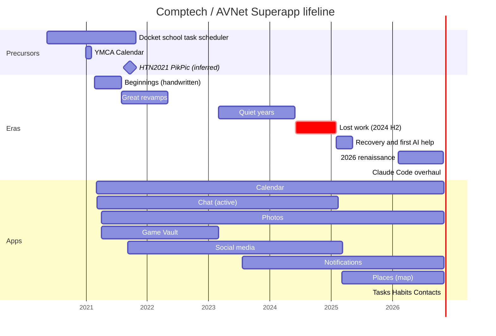

# My Very Own Tech Giant: A History of AVNet Superapp (V1)

*From a high-school homework planner to a self-hosted superapp, 2020 to 2026.*

---

## Preface

Every big tech company has an origin story with a garage in it. Mine has a school timetable, a YMCA calendar, a hackathon weekend, a dead SSD and roughly two hundred commits, many of them called "Did stuff".

This book traces that story from the first line of the first precursor in 2020 to the night in November 2026 when Claude Code helped me rebuild the whole thing. It covers what was built, when, and what happened to it: what survived, what got rewritten three times, and what quietly died. Wherever I can, I cite real commits (short hash and date) from this repository's history. Where a claim rests on file dates or on reading old code, I say so and give the evidence.

A few ground rules for reading:

- **Dates** come from `git log --date=short` (author dates). For the precursor projects without git history, I use file modification times, and I mark those dates as *inferred*.
- **Hashes** are the 7-character short hashes from this repo. `git show <hash>` takes you to the moment.
- **"Comptech"** is the original name. The visible product became **AVNet Superapp** on 2026-11-04 (`7f66355`). The code still says `Comptech` everywhere, and so does this book when it talks about the old days.
- **Authorship.** Everything before roughly February 2025 I wrote entirely by hand, starting in high school. From February 2025 on I used AI coding tools more and more, and the November 2026 overhaul was done end to end with Claude Code. The chapters say which era is which.

---

## Table of contents

1. [Timeline at a glance](#timeline-at-a-glance)
2. [Chapter 0: Origins, the precursors (2020 to 2021)](#chapter-0-origins-the-precursors-2020-to-2021)
3. [Chapter 1: Comptech is born (February to July 2021)](#chapter-1-comptech-is-born-february-to-july-2021)
4. [Chapter 2: The great revamps (July 2021 to May 2022)](#chapter-2-the-great-revamps-july-2021-to-may-2022)
5. [Chapter 3: The quiet years (2023 to mid-2024)](#chapter-3-the-quiet-years-2023-to-mid-2024)
6. [Chapter 4: Lost and found (late 2024 to February 2025)](#chapter-4-lost-and-found-late-2024-to-february-2025)
7. [Chapter 5: Foreman for LLMs (February to May 2025)](#chapter-5-foreman-for-llms-february-to-may-2025)
8. [Chapter 6: The 2026 renaissance, with AI at the keyboard (February to early November 2026)](#chapter-6-the-2026-renaissance-with-ai-at-the-keyboard-february-to-early-november-2026)
9. [Chapter 7: Two nights in November, the Claude Code overhaul (4 to 5 November 2026)](#chapter-7-two-nights-in-november-the-claude-code-overhaul-4-to-5-november-2026)
10. [Chapter 8: What's next, V2 and Memex](#chapter-8-whats-next-v2-and-memex)
11. [Appendix A: Feature ledgers, app by app](#appendix-a-feature-ledgers-app-by-app)
12. [Appendix B: The apps that didn't make it](#appendix-b-the-apps-that-didnt-make-it)
13. [Appendix C: Stats](#appendix-c-stats)
14. [Appendix D: Commit-message hall of fame](#appendix-d-commit-message-hall-of-fame)
15. [Appendix E: Sources and what I couldn't confirm](#appendix-e-sources-and-what-i-couldnt-confirm)

---

## Timeline at a glance

| When | Era | Milestone |
|---|---|---|
| 2020-05 | Precursors | **Docket**, my school task scheduler, gets its first commit (2020-05-12) and is deployed a week later (2020-05-19) |
| 2020-08 → 2020-11 | Precursors | Docket gains invites, organisation-wide events, timetables, an indoor school map, then chat, video call and a homepage ("REV 1.1", 2020-11-04) |
| 2020-12 → 2021-01 | Precursors | **YMCA Calendar**: a group calendar built from Docket's ideas, deployed 2021-01-31 |
| 2021-02-19 | Beginnings | **Comptech's first commit** (`4f094bb`): a basic site and a login page with a background image |
| 2021-03-02 | Beginnings | Calendar (from YMCA Calendar), home page and navbar arrive (`12a267d`); school features stripped the same day (`a3ab884`) |
| 2021-03-06 → 03-23 | Beginnings | Chat app started, then working over WebSockets (`494a8b7`, `5af3efe`) |
| 2021-04-03 | Beginnings | Photos stub, Game Vault (Flappy Block, a YMCA game) and micro-apps (`3600020`) |
| 2021-05 | Beginnings | Countdown page, Scrabble, friend requests (`967bb5c`); Comptech becomes an OpenID Connect provider (`083cf2c`) |
| 2021-06-06 | Beginnings | First pull request: **Google Calendar sync** (Gitea PR #1, `0d5a0c1`) |
| 2021-07-30 | Revamp | "Completely Revamp the entire codebase Part 1" (`b0bc811`) |
| 2021-09 | Revamp | "Ready for CareerConnect" (`8357afa`); social media app scaffolded. **HTN2021** "PikPic" photo search hack (inferred from file dates, 18 to 19 September) |
| 2021-11-13 | Revamp | Complete Calendar revamp: subscriber roles, todos, ICS calendars (`8ca4043`) |
| 2021-12-28 | Revamp | Calendar JS split out, dark and light calendar styles, `sync.py` (`80c8c90`) |
| 2022-05-01 | Revamp | "Making the Program of Theseus!": the calendar's JSON API moves into `scheduler/api.py` (`ab7d7b7`) |
| 2023-02-28 | Quiet years | **Photos revamp**, Celery, availability and public calendar pages, UWaterloo WCMS sync (`5f8f34f`) |
| 2023-07-21 | Quiet years | Photo GeoGuessr game, notifications app stub, Makefile, `base_v2.html` (`97db631`) |
| 2024-03 → 04 | Quiet years | Todo statuses, a first Habits model, UW course injection (`d7fa84f`, `990018e`) |
| 2024-05-31 | Quiet years | Last commit before the gap (`6f7b051`) |
| 2024 H2 | Lost | Work on a handwritten V2 API and more; lost in the January 2025 SSD failure |
| 2025-01 | Lost | **SSD failure**, major data loss on the server |
| 2025-02-12 | Recovery | "RECOVER BACKUP FROM DATA LOSS" (`d09728d`); restoration finalised next day (`f641265`) |
| 2025-03-11 | AI-assisted | "I am a foreman for LLMs - Speedran the Map app" (`3424b18`); Photos UI "feat. Cursor" |
| 2025-05-09 | AI-assisted | Photo heatmap sped up with a materialized view (`535b99f`) |
| 2026-02 | AI-assisted | Shared albums, scheduled Celery ingest, **YOLO object search** (`c477ed1`, `90d790b`, `8d73cfa`) |
| 2026-04-06 | AI-assisted | First GitHub PRs authored by **Claude on the web** (OSM compliance, PR #1 and #2) |
| 2026-05 → 09 | AI-assisted | Photos: AI indexing on ingest, video object detection, stats, storage, search, RAW, superlatives, upload page, nested albums |
| 2026-11-04 | Claude Code | **Phase 1**: critical security fixes and local dev environment (PR #10) |
| 2026-11-04 → 05 | Claude Code | **`improve/phase-1`**: theme and dark mode, notifications, V2 API, Tasks, Habits, Contacts, Places, Photos redesign, API keys, ICS feeds, analytics, React UI; product renamed **AVNet Superapp** |
| Next | V2 | **Memex**, a modular rewrite being planned separately |

---

## Chapter 0: Origins, the precursors (2020 to 2021)

Comptech didn't appear from nowhere. Three earlier projects in `~/Desktop/Programming/_OLD/` hold most of its DNA: one for structure, one for the calendar's actual JavaScript, and one for an idea that took five years to come back.

### Docket, the School Task Scheduler (May 2020 to October 2021)

*Folder:* `_OLD/SchoolTaskScheduler/`, four copies: `Docket`, `Docket_Deploy`, `DocketDemo` and `Docket_OIDC`. All four are git repos, all commits by me.

Docket was a Django web app for running a school's day-to-day: classes, teachers and students, assignments with deadlines and priorities, events, and a rotating day/period timetable. Its first commit is "Initial" on **2020-05-12**, followed the same day by "Created calendar". Some skeleton files carry a modification date of 2020-03-19 (*inferred*: the project may have been set up two months before the first commit). It was a pandemic-era high-school project in every sense.

The git log reads like a diary of a teenager shipping software:

- **2020-05-19**, "Finally ready to deploy". Docket went to Heroku (a `Procfile`, `gunicorn`, `whitenoise`, `dj-database-url`). Commit `6b909f2` on the same day is called "Added Ads".
- **August 2020**, "REV 0.9 Almost ready for distribution", then an upgraded invite system (`84c2793`, 2020-08-22), organisation-wide events (`f83fe44`, 2020-08-27) and timetables (`9dd4ee2`, 2020-08-29).
- **2020-08-31 to 2020-09-04**, a **Map** app, "V0.9.9 Finished Map, Created error pages" (`21d8efb`). This was an indoor map of the school: venues, floors and floor plans (`School_Ground_Floor.jpg`, `School_First_Floor.jpg`), rooms, entrances and "floor transport", drawn with **Leaflet** and **Handlebars** and editable by admins.
- **2020-11-04**, "REV 1.1 Added Chat, Videocall and Homepage app" (`47ba860`). Docket now had `chat` (direct messages and group DMs), `videochat`, `home` and a `stats` app that recorded each client device's browser, OS, screen size, CPU cores and memory.
- **2021-06-09 to 2021-06-19**, the `DocketDemo` copy got "REV 2.0", a demo deployment, a run of suggestion-driven changes ("SUGGESTION 3: Colour Coding") and an onboarding modal. It contains some of my all-time best commit messages: "Pray it work", "sdf sdfasd fdafsa dsaf s", and the four-commit sequence "E", "EE", "EEE", "EEEE".
- **2021-10-24**, "Shut Down" (`b5ce8f0`).
- `Docket_OIDC` (last database write 2021-05-28) wires Docket's login to an OpenID Connect provider at `/openid/authorize/` using `mozilla_django_oidc`. That is exactly the endpoint Comptech started serving on 2021-05-09 (see Chapter 1), so it's very likely I was testing "Log in with Comptech" on Docket.

**What carried into Comptech:**

- **The calendar's bones.** Comptech's very first scheduler (`12a267d`, 2021-03-02) shipped with Docket's school models still in it: `Class`, `Assignment`, `Invite` (8-character codes with a use counter), `Period`, `Day`, plus Docket's `admin.html`, `schedule.html` and `settings.html` templates. The same day, commit `a3ab884` ("Modified calendar, removed school-related features") deleted the admin and settings pages and turned the calendar personal. The invite-code idea survives today: Calendar still shares calendars with invite codes.
- **Assignments became Todos, and Todos became Tasks.** Docket's `Assignment` (deadline, URL, description, priority) is the ancestor of the calendar's `Todo` (`8ca4043`, 2021-11-13), which the 2026 Tasks app is built on.
- **Chat, map and stats.** Comptech started its own chat in March 2021 and got a map app in March 2025. Its first commit (`4f094bb`) vendored `uaparser.js`, `leaflet.js` and `handlebars.js`: the same trio Docket used for device stats and the school map. The 2026 usage analytics app is, in spirit, Docket's `stats` grown up (and made much more privacy-respecting).
- **The `getinfo()` habit.** Docket's models each had a `getinfo()` method returning a dict for JSON responses. Comptech's `ComptechUser`, `Calendar` and friends kept that pattern for years.

### YMCA Calendar (December 2020 to January 2021)

*Folder:* `_OLD/YMCACalendar/YMCACalendar/`, a git repo with 20 commits.

A smaller, focused Django app: a calendar for a YMCA program's **groups**. Each group had a code, a location, an address and an advisor's contact details; events belonged to a group or to everyone. Visitors picked their group and saw a month view of its events. It even carried a `VARS` setting for a rotating "DAY" schedule (a four-day cycle with weekends as holidays), which is very Docket.

- Migrations are dated **2020-12-31** to **2021-01-09** (*inferred* from file times).
- All 20 commits landed on **2021-01-31**: "make it better", then nineteen variations of "Ready for deploy" and "Ready to deploy". Anyone who has fought Heroku will recognise the pattern.
- Stack: Django, crispy-forms, Heroku (`Procfile`, `runtime.txt` = python-3.9.0), gunicorn, whitenoise, Postgres.

**What carried into Comptech:** the calendar's front-end code, almost literally. Comptech's first `scheduler/static/scheduler/calendar.js` (`12a267d`) differs from YMCA Calendar's `calendar.js` by **three lines** (short day names, one string concatenation, and the click handler on each date cell). The CSS file names (`calendar.css`, `styles.css`) and the `getinfo()` model style match too. Comptech's first commit came 19 days after YMCA Calendar's deploy marathon, and its first scheduler arrived 30 days after it.

Two YMCA side quests also left a mark: `_OLD/YMCAGame/` (a small Python game, June 2021) and a `ymca_game.html` page in Comptech's Game Vault (`3600020`, 2021-04-03).

### HTN2021, "PikPic" (September 2021)

*Folder:* `_OLD/HTN2021/`, no git history.

The file dates (**2021-09-18** and **2021-09-19**) line up with the Hack the North 2021 weekend, and the folder name says the rest, so this was very likely my HTN2021 project (*inferred*). It's a Flask app called **PikPic**, "a fast and efficient way to view, and search the photos on your computer". Its `indexer.py` walked a folder and, for each image:

- detected **objects** with YOLOv3 (OpenCV's DNN module and the COCO labels);
- read **text** with Tesseract OCR;
- recognised **faces** with FaceNet embeddings and cosine similarity against a folder of known faces;
- made thumbnails and kept a history of indexed folders.

Side experiments in the same folder: MediaPipe selfie segmentation, a ResNet-based image captioner, and a histogram-based "find similar photos" script. `ImgScan/app.py` was last touched on 2022-08-06, so I came back to it at least once.

**What carried into Comptech:** the idea of *searching your photos by what's in them*. Comptech's Photos app was still a stub in September 2021. Object search finally arrived on **2026-02-05** as "YOLO-based image object search" (`8d73cfa`), this time with YOLOv11 through `ultralytics`. Today's Photos search covers place, camera and object. Face recognition hasn't made the jump (yet).

### A footnote: `ComptechWebsite` (May 2021)

`_OLD/ComptechWebsite/` is an empty Django project with a `mainsite` app, all files dated 2021-05-17 (*inferred*). It looks like a short-lived attempt at a separate public "Comptech" site, three months after the real repo started. Nothing in it carried over.

---

## Chapter 1: Comptech is born (February to July 2021)

**34 commits (plus 3 merges) · 2021-02-19 → 2021-07-14 · all handwritten**

The README written on 2021-06-06 (`8ec87c2`) states the mission in four words that still head the README today: **"My very own tech giant."** It also set rules that have survived every rewrite: never share the code, never load CSS or JS from a CDN, and never call another company's servers without my consent.

### The first weeks

- **2021-02-19, `4f094bb`, "Created basic site, and login page with background".** Django settings, a custom `ComptechUser` model (profile picture, description, a `newuser` flag), login and register pages, and a `bg_images` app whose only job was to serve big landscape photos behind the login form. The README later warned that a fresh install would crash until you uploaded a background image through the admin.
- **2021-02-22, `1e65a63`**, "Added SSL encryption".
- **2021-02-24, `7932582`**, mobile-friendly login and the start of profiles.
- **2021-03-02, `12a267d`, "Added calendar, Started on mainsite, added Navbar".** The scheduler app arrives with Docket's models and YMCA Calendar's JavaScript (Chapter 0), plus the `mainsite` home and apps pages and 400/403/404/500 error pages. Later that day, `a3ab884` strips the school features.

### Chat, games and everything else

- **2021-03-06, `494a8b7`**, "Misc additions, started chat app". ASGI routing went in for Django Channels.
- **2021-03-15, `5ee60a1`**, "Worked on chat...". WebSocket consumers, plus the first `dark_mode` field on the user model. It lived until 2026-11-04.
- **2021-03-23, `5af3efe`**, "Made Chat Functional".
- **2021-04-03, `3600020`, "Did all kinds of stuff, cant explain here :D".** In one commit: a `photos` app (empty), a `gamevault` app with **Flappy Block** and the **YMCA game**, a `microapps/birthday` app (gone a week later in `7c6d67e`), AOS scroll animations, and 1,336 lines of changes to the calendar template.
- **2021-04-10, `7c6d67e`**, "Did a lot of stuff in multiple apps". Password reset pages arrive.
- **2021-05-01, `967bb5c`, "I wrote some code".** It's an understatement: a multiplayer **Scrabble** game over WebSockets, a **countdown** page, and friend requests in the users app.
- **2021-05-05 and 2021-05-09**, "Finalized Calendar" (`6641c1e`), then "Completely Finished Calendar" (`083cf2c`). The calendar was, of course, not finished: by my count it was revamped at least four more times. `083cf2c` also made Comptech an **OpenID Connect provider** (`oidc_provider`, `/openid/`) and added a credits page.
- **2021-05-31, `3dda934`**, "Did stuff". The first real `Photo` model, photo pages and a `ding.wav` notification sound for chat.

### Getting organised

June 2021 is when Comptech started acting like a real project:

- **2021-06-01, `675facb`**, the first README.
- **2021-06-03, `95ff0d4`**, "Functional Version". Calendars get a `calendar_type`.
- **2021-06-04, `21729b1`**, calendar sync built on a local model.
- **2021-06-06, `0d5a0c1`**, **the first merged pull request**: "Added Google Calendar sync capability" (#1, branch `Google_Calendar`). It was reviewed on my own **Gitea** server, which also hosted the clone URL in the README.
- **2021-06-06, `2bdbf0e`**, import/export in the admin (`django-import-export`).
- **2021-06-12, `cf051bc`**, the first `requirements.txt`.
- **2021-06-18, `d1e5cff`**, the only commit in the whole history by another human: a contributor named Bala "Fixed typo in README".
- **2021-06-20**, "Removed SSL Certificates" from the repo (`a2fe3e6`) and "Upgraded security" (`701d86d`). It was a good instinct, even if secrets would keep turning up in the code until 2026.
- **2021-07-09, `575f547`**, PR #2, `Upgrade_Calendar`.
- **2021-07-10, `6153512`**, "UWU".
- **2021-07-14, `1865a72`**, "Calendar Upgrade #65536". It also swapped the full `moment.js` (18,083 lines) for the minified build.

By mid-July 2021, Comptech had accounts, a calendar with Google sync, a countdown, a working chat, two games, the beginnings of photos and a home page linking it all together.

---

## Chapter 2: The great revamps (July 2021 to May 2022)

**9 commits · 2021-07-30 → 2022-05-01 · handwritten**

Fewer commits, much bigger ones. This is where I learned that code you wrote six months ago is code somebody else wrote.

- **2021-07-30, `b0bc811`, "Completely Revamp the entire codebase Part 1".** A rework of the calendar models and views (613 lines of template changes) and a `users/getinfo.py` helper. There is no "Part 2" commit. Make of that what you will.
- **2021-08-07, `9b4c2c3`**, "Changed Homepage".
- **2021-09-04, `8357afa`, "Ready for CareerConnect".** The calendar got polish and a `socialmedia` app appeared as a scaffold. I'm fairly sure CareerConnect was an event where I showed the project, but the commit is the only evidence.
- **2021-11-13, `8ca4043`, "Complete Calendar Revamp, Other Updates."** The data model that still underlies Calendar today: calendar types (local, **ICalendar**, Google), a `Subscriber` table with **roles** (Owner, Admin, Subscriber), and the first **`Todo`** model. It brought 1,026 lines of calendar-template changes and a calendar sound effect.
- **2021-12-28, `80c8c90`, "Upgraded Calendar, made it more efficient".** The calendar's JavaScript moved out of the template into `scheduler/static/scheduler/script.js` (1,457 lines; the file still exists), with separate **dark and light calendar stylesheets** and a dedicated `scheduler/sync.py`.
- **2022-02-06, `f47bb10`, "Calendar V 5.0.2".** Yes, the calendar had version numbers. This commit also brought the first photo **`Album`**.
- **2022-04-08, `508a60b`**, "Misc. Changes". Chat commands, a bigger profile page, and a social media data model.
- **2022-05-01, `ab7d7b7`, "Making the Program of Theseus!"** My favourite commit title in the repo. The calendar's `views.py` lost about 450 lines, and its JSON endpoints were rebuilt in a new 409-line `scheduler/api.py`. The joke is the Ship of Theseus: replace every plank and ask whether it's the same ship. Four years later, the November 2026 overhaul did the same to the whole platform.

---

## Chapter 3: The quiet years (2023 to mid-2024)

**9 commits · 2023-02-28 → 2024-05-31 · handwritten**

University years, judging by the gaps (and by a commit called "Added UW course info"). Commits got rare, but each one carried a season of work.

### 2023: Photos grows up

- **2023-02-28, `0e78b72`**, "Removed Unwanted Files". Game Vault (Flappy Block, Scrabble) and the OIDC provider settings were deleted.
- **2023-02-28, `5f8f34f`, "Complete revamp of Photos app, delete unused code."** The most important commit of the decade for Photos, and a big one for Calendar too:
  - a photo timeline, day pages and a **photo map with a heatmap**;
  - indexing scripts (`scripts/indeximg.py`, `adddate.py`, `genthumbnail.py`) that read dates and EXIF and made thumbnails;
  - **Celery** (`Comptech/celery.py`, `scheduler/tasks.py`) for background work and calendar **auto-sync**;
  - an **availability** page and a **public** calendar page;
  - **UWaterloo WCMS** event sync, through calendar type 50 in `sync.py` (the README later called this "the UWaterloo calendar integration").
- **2023-04-09, `dcb7b93`**, "Removed useless bg_images app, improved photos". The login background app from the very first commit retired after two years.
- **2023-06-09, `5ce0810`**, "Updated Photos map year range".
- **2023-07-21, `97db631`, "Did stuff".** It understates again: a **photo GeoGuessr** game (guess where your own photo was taken), a new calendar page (`calendar.html`), a new base template (`base_v2.html`), a `Makefile`, and the first **notifications** app (empty).

### 2024: Todos, habits and courses

- **2024-03-28, `d7fa84f`, "Did some things".** Todos got richer (statuses, completion tracking, extra fields), a first **`Habit`** model appeared in the scheduler, `scheduler/inject.py` started importing course schedules, a notification model arrived, and Photos gained a photo viewer page and a second GeoGuessr mode.
- **2024-04-01, `990018e`**, "Added UW course info". Course injection gets reworked (115 lines changed in `inject.py`). This is very likely the University of Waterloo, given the WCMS sync.
- **2024-05-07, `44ca503`**, "Photos security improvements, DB changes". The photo indexer moved into the app (`photos/indeximg.py`), and notifications got device groups and expiry dates.
- **2024-05-31, `6f7b051`**, "Update gitignore and readme". **This is the last commit before the gap.**

---

## Chapter 4: Lost and found (late 2024 to February 2025)

There are no commits between **2024-05-31** and **2025-02-02**. The silence isn't idleness.

During the second half of 2024 I kept building on the server, including a **handwritten V2 API**. Most of it never reached this repository. In **January 2025**, the server's SSD failed, and most of the code from the second half of 2024 went with it, V2 API included.

What came back was a **backup from April 2024**. The README, edited during the recovery (`f641265`), says so plainly:

> My very own tech giant. (Recovered backup from April 2024 modified for running with the current server setup)

and, a line later:

> WARNING: This is a half-decade old codebase carrying all the technical debt that high school me created.

The recovery, step by step:

- **2025-02-02, `a10a69f`**, a revert of the May 2024 "Update gitignore and readme" commit. Getting the repo back to a known state was step one.
- **2025-02-12, `d09728d`, "RECOVER BACKUP FROM DATA LOSS".** Settings were adjusted for the current server. **Chat was switched off** (removed from `INSTALLED_APPS`; its separate `chat_db` database and Redis channel layer were commented out), and so was the social media app. An `nginx.conf` with `secure_link`-protected media appeared, along with new photo fields for EXIF data and AI index info, and the dependencies the new server needed (OpenCV, NumPy, Celery, Daphne).
- **2025-02-13, `f641265`**, "Finalize restoration from backup, optimize codebase, add photo delete feature, and code to geerate video thumbnails". It also brought a 135-line `scripts/ingest_existing.py` for re-importing an existing photo library.
- **2025-02-24, `5a1a27b`**, "Added extra scripts". GPX-based location finding and a script that guesses a photo's location from its neighbours.

A small detail in the history may be the ghost of the lost API. On **2025-03-11**, commit `dc51d52` ("Added new API files") created two empty files: `photos/api_v2.py` and `scheduler/api_v2.py`. They stayed empty. A typed V2 API finally shipped on 2026-11-04 (`9c0b9a0`), built with Django Ninja.

> **Lesson recorded for posterity:** the git remote held history up to May 2024, the server held everything after, and the SSD held the server. Every upgrade guide written in 2026 starts with `pg_dump`.

---

## Chapter 5: Foreman for LLMs (February to May 2025)

**19 commits · 2025-02-02 → 2025-05-09 · the AI-assisted era begins**

From February 2025 on, I wrote much of the new code with AI coding tools. The commit log shows the change in pace right away: **14 commits in March 2025**, more than in all of 2022, 2023 and 2024 combined (12).

- **2025-03-07, `97ef189`**, "Added basic Map app" (17 lines of scaffolding).
- **2025-03-07, `d8724d5`**, a fix for all-day ICS events in calendar sync.
- **2025-03-11, `3424b18`, "I am a foreman for LLMs - Speedran the Map app".** Four days after the scaffold: 1,143 new lines, including a 780-line map page with location categories and admin. The commit title is my own job description for this era: I directed, the models typed.
- **2025-03-11, `d44411e`**, "Removed useless Social Media app". It lasted from September 2021 and never got past a scaffold.
- **2025-03-11, `eb6bf5d` and `da60f39`**, "Photos UI changes feat. Cursor" and "More Photos UI updates, cities display feat. Cursor". The first AI tool **named in a commit message** is Cursor. The second commit added offline reverse geocoding so photos show their city.
- **2025-03-11, `dff99bc`**, "Added Neonatim integration and ability to create location groups". That's Nominatim, OpenStreetMap's place search, misspelled, and a reliable sign of a human writing commit messages at speed.
- **2025-03-11, `7b7f659`**, "Stop tracking NGINX conf".
- **2025-03-26, `2103918`**, video metadata through **exiftool**, plus bitrate, megapixels and MIME type fields on photos.
- **2025-05-09, `535b99f`**, "Sped up photos heatmap with a materialized view". A Postgres materialized view (`photos_photo_location_cache`) pre-aggregates photo locations so the heatmap loads fast. Its SQL definition was committed later (`24b41b5`, 2026-02-04).

Then nine months of quiet, from May 2025 to February 2026.

> **On which tools, when.** I remember this era as mostly Google's **Antigravity**, with Claude on the web joining later. The commit log adds detail: the only tool named in a 2025 commit message is **Cursor** (March 2025). Antigravity was released publicly in late 2025, so it most likely powered the 2026 commits in Chapter 6 rather than the March 2025 ones. Commits authored by **Claude** start on 2026-04-06.

---

## Chapter 6: The 2026 renaissance, with AI at the keyboard (February to early November 2026)

**54 commits plus 8 merges · 2026-02-04 → 2026-11-02 · AI-assisted (Antigravity, then Claude on the web as well)**

2026 is when the project woke up properly. In the first half of the year, commits arrived in themed bursts, often several in a day. Mid-year, a new author started showing up in `git log`: **Claude**, opening pull requests on GitHub from Claude on the web (each commit links its `claude.ai/code` session). Ten GitHub PRs were opened in 2026; nine are merged and one (#8) is still open.

### February and March: albums, Celery and seeing objects

- **2026-02-04, `c477ed1`**, "[Photos] Shared albums". Albums can be shared with other users or made public. The same commit **removed the 2024 `Habit` model** from the scheduler; habits would come back in November as an app of their own.
- **2026-02-04, `90d790b`**, "Added Celery task scheduling". Photo ingest runs on a schedule, and `Comptech.sh` starts the tmux session (Daphne, Celery worker, Celery beat) that still runs the server today.
- **2026-02-05, `8d73cfa`, "YOLO-based image object search".** HTN2021's dream, five years later: `photos/AI/objects.py` runs YOLOv11 over the library and makes it searchable by object.
- **2026-02-05, `44b4141`**, better sidebar filters and a shared `photos_base.html`.
- **2026-03-12**, a Calendar day: the day/week modal refactor (`372de54`), the "Refactor Calendar frontend - Day and Week view" (`3152b04`, 800 lines), simpler event loading with **Google Calendar-style keyboard shortcuts** (`295b079`), and a list-render fix (`aadfddd`). Object detection got updates too (`35df514`).

### April: Claude arrives

- **2026-04-06, `75c0874`** (PR #1) and **`d04943d`** (PR #2), both by Claude. Map searches now go through a server-side **Nominatim proxy** with a proper User-Agent, tile layers carry OpenStreetMap attribution, and a referrer-policy change fixed blocked tiles (403s). These are the first commits by an AI author, and the first not written by me since Bala's 2021 typo fix.
- **2026-04-19, `e4cd403`** (PR #3), Claude writes the `docs/` folder: data models and ETL pipelines for Calendar and Photos (1,104 lines). It was the first real technical documentation in five years.

### May: the photo engine

**25 commits, the busiest month until November.**

- **2026-05-11**, PRs #4 to #7 (Claude): AI indexing runs automatically after each ingest (`5edf44b`); **videos get object detection** by sampling frames at a rate scaled to their length (`0961873`); a BGR/RGB mix-up that produced zero detections is fixed (`bb8c8ff`, `484c46f`); and **city detection** is reworked (`b62c670`, `ad5a115`, `6fe69c9`, `4f020ba`). It went from "nearest place" to a population-and-distance score, so a photo in downtown Toronto says "Toronto" and not a neighbourhood name. I tuned it again the same day (`604fe4b`) and fixed photo times to always show local time (`fcf7bd6`).
- **2026-05-28**, a refactoring day: the calendar timezone bug (`49e1618`), **the Map app moved into proper static files** (`b93ff46`, 1,491 lines in, 902 out), and the Photos UI refactor (`87b82fe`, `08fc109`, `cae7182`).
- **2026-05-29**, a feature day: **Stats and Storage pages** (`8f64dae`, `d3d6dae`), **RAW file parsing** with RAW/JPEG matching (`24182b2`), a stop to the auto-reloading photos page (`3d14922`), a **Search page** (`8b47b30`), and a **justified photo grid** (`432f18d`, "Justify all images").

### June to September: polish and superlatives

- **2026-06-01**, "Fix tech debt" (`93c3e5c`), a time-taken overlay on photos (`7cfa130`), and a commit called "Stuff" (`c9edc2b`).
- **2026-06-03, `d1ce124`** (PR #8, still open), Claude writes `REWRITE_REPORT.md`: "Codebase Inventory & Rewrite Brief", a full feature inventory meant as the spec for a from-scratch rewrite. It's an early step on the road to Memex (Chapter 8).
- **2026-06-04**, Photos improvements and detail display options (`c068c11`, `cdc7f97`, `6c8ec8f`).
- **2026-06-28**, **perceptual hashes and blur scores** (`36ac8d0`) for duplicate and quality detection, plus an `index_photos` management command. More fixes followed the same day (`24f07d2`, `16417a7`, `9d5735e`).
- **2026-07-14, `62746a1`** (PR #9, Claude), the original per-photo "dot" heatmap returns beside the blob heatmap (`?style=dot`), with a `?date=` filter for plotting a single day.
- **2026-07-31**, the **Superlatives** page (`de24b8e`, `41a6ef0`, `33c7822`): biggest, furthest, busiest days and more. pHash came out again (`263eba9`) and the ingestion pipeline got simpler (`42bc63b`).
- **2026-08-07, `624f95c`**, "Add (back) media upload page". The "(back)" is a quiet nod to something lost along the way.
- **2026-09-10, `7bd381f`**, calendar event descriptions parse properly.
- **2026-09-14, `55d4216`**, a new photo ingest process, **parent/child albums**, and "importables" (296 lines).
- **2026-11-02, `a0cbbdc`**, "Stuff". In fact, a 261-line **video compressor** (`photos/compressvideo.py`) and a sync fix. It's the last commit before Claude Code took the wheel.

---

## Chapter 7: Two nights in November, the Claude Code overhaul (4 to 5 November 2026)

**About 110 commits · 2026-11-04 20:39 → 2026-11-05 · Claude Code end to end**

The last couple of days of this history were done entirely in Claude Code, in two moves: **Phase 1**, an audit-driven bug-fix pass merged as PR #10, then **`improve/phase-1`**, a platform-wide upgrade on top of it.

A note on timestamps: the 65 commits are packed into a few hours (between 20:39 on 4 November and about 01:10 on 5 November). They record when the finished work was **committed** in reviewable slices, not every hour it took to build. The work itself happened over the preceding couple of days.

### Phase 1: fixing what was broken (PR #10, `fix/critical-bugs`)

Merged as **`3b9be79`** on 2026-11-04 (GitHub records 2026-11-05 01:52 UTC). Seventeen commits:

| Commit | What it fixed |
|---|---|
| `00391c9` | **Critical security fixes from the audit.** Calendar write access checks, album and photo scoping, safe `?next=` redirects, re-encoded profile pictures, parameterised SQL in `inject.py`, sanitised and escaped user text, API keys moved out of the code into untracked files, `X-Frame-Options`, and Celery limited to JSON (no pickle) |
| `e16bc3f` | **A local testing environment**: SQLite, no Redis, no nginx, Celery tasks run inline, dummy data, and `localdev/smoke.py`, which logs in and checks every page |
| `0d97171`, `f68dccb` | Shared mutable JSON defaults fixed; exception details never sent to the browser |
| `eda9365` | Photos ingest scans `Ingest/` recursively and stores timezone-aware dates |
| `fade2ea`, `e26a058`, `b45ebdc` | Calendar month and day queries, subscribing, unsubscribing, invites and the public page; no state changes on GET; subscribers only see calendar names |
| `2f90cab` | Profiles and profile pictures require login |
| `551948b` | **The chat app is removed** (717 lines), four and a half years after its last feature and 21 months after it was switched off |
| `56fdb58`, `0456905` | Places edits no longer wipe fields; home greeting, reminders, search and lists fixed |
| `f226d7a` | `ALLOWED_HOSTS` was `'*'`; now only known hostnames |
| `0554c5b`, `8b93680` | **No CDNs, no vendored blobs**: 52 third-party files (44,693 lines) leave git and are fetched at deploy time, pinned by SHA-256 in `static_files/vendor.lock`. The 2021 README's rule 2 ("DO NOT use the CDN links") is enforced at last |
| `7d9d0db`, `3132d02` | Same-origin framing for calendar photo pop-ups; a step-by-step server upgrade guide (`docs/UPGRADE-fix-critical-bugs.md`) |

### `improve/phase-1`: the platform upgrade

Everything below is on the `improve/phase-1` branch, dated 2026-11-04 or 2026-11-05.

**Design system and dark mode**

- `97acbc9`, redesigned sign-in, password-change and register pages, plus a **theme system**.
- `e242d04`, the app shell on **Bootstrap 5.3** with the shared theme: navbar, sidebars and a dark mode toggle.
- `3580db9`, `9a6d19a`, `8d652a0`, `5774a48`, home, launcher, profile and error pages, then **Places**, **Photos** and **Calendar** restyled on the shared theme (Calendar alone was 2,091 lines in and 996 out).
- `b392e0d`, a compact modal type scale and rem-based scaling for 4K screens; `localdev/screens.py --4k` for screenshots.
- `427317f`, removed Bootstrap 5.0-beta and 5.1.3, the per-account `dark_mode` field from March 2021, and `base_old.html`. Dark mode is now chosen per device.
- `7d0605f`, inline JS and CSS moved into static files; `16c8297`, each classic app remembers whether its sidebars are open.

**The rename.** `7f66355`, "Rename the visible product name to AVNet Superapp (code names unchanged)". After five and a half years as Comptech, the product got its current name. The Django project, the database and `Comptech.sh` kept the old one.

**Notifications.** `5e9b1a7` builds a real notifications system: an inbox, a bell menu with unread badges, and delivery to **ntfy, Gotify, email, Discord or any webhook**, with LAN-only destinations while `ONLINE_MODE` is off. `4004074` sends notifications from calendar subscriptions, album shares, ingest summaries and auto-sync failures. `59503ef` adds **automatic reminders** for events, deadlines and todos, plus a morning agenda.

**The V2 API, take two.** `5e9b1a7` stands up `/api/v2/` on **Django Ninja**, and `9c0b9a0` adds `me`, calendar (calendars and events), photos (timeline, albums, on this day, summary) and places. `6721d0e` adds **per-app API keys** (`avn_…` tokens stored hashed and shown once, read/write scopes per app, expiry) and **Markdown API guides for AI agents** at `/api/v2/<app>/guide.md`, generated from the live schema. `8f73e8a` keys the rate limit (600 requests per minute) by user or key. Almost two years after the handwritten V2 API died with the SSD, a typed one shipped.

**Tasks.** Five years after `Todo` and six after Docket's `Assignment`:

- `bae08ee`, the Tasks backend: projects, kanban buckets with WIP limits, labels, reminders, comments, relations, saved views, recurring tasks, sharing, and **natural-language quick add** (`"Pay rent tomorrow 5pm *bills +Home !3 every month"`). It is built on the old `scheduler.Todo`, so Calendar and Home kept working.
- `00b6928`, `0b93a6c`, the `/tasks/` route and launcher tile.
- `4929cbd`, the **Tasks page**: smart views, nested projects, list, board, table, calendar and timeline views, a detail drawer, quick add with live preview, bulk actions, drag and drop, keyboard shortcuts, focus mode and deep links (4,450 lines).
- `97b5221`, API refinements, including the ruling that **"tonight" means 8 pm**.

**Habits.** Scaffolded in `6721d0e`, then **rebuilt** in `20c2089` (2026-11-05): yes/no and measurable habits, at-least and at-most goals per day, week or month, schedules, time-zone-correct days, backfill, streaks that respect skips and pauses, a Loop-style habit score, a year heatmap, reminders and an evening nudge.

**Contacts.** Scaffolded in `6721d0e`, then built out in `cbed793` (2026-11-05, 4,988 lines): a personal CRM with vCard, Google, Outlook, LinkedIn and CSV import (with preview, dedupe and merge), 30 developer and social profile networks, interactions, relationships, keep-in-touch and birthday reminders, and vCard/CSV export.

**Places.** `c1b523a`, a detail panel, photos taken nearby with visit history, **suggested places from photo GPS**, want-to-go and visited lists, GeoJSON, Google Takeout and KML import and export, marker clustering, and stats (2,924 lines in).

**Calendar.** `d6e0e3f`, an **Insight** tab (week and month charts and facts), an **Upcoming** agenda, "Add to tasks", task quick add and a pile of fixes. `a00b113` adds a previous-period photo count to insights.

**ICS feeds.** `44cd184` and `1f1c541`, private, revocable, hashed feed URLs for calendar events and tasks with due dates, so phone calendar apps can subscribe. They're managed next to API keys in Settings.

**Photos.** `212d93e` fixes sideways video thumbnails and swapped dimensions. `8b5985f` fixes an upload page whose `csrfToken` constant clashed with a global and silently broke its whole script. `e6449c2` adds **hidden photos**: an owner-only flag, revealed only through a 30-minute session mode that never works over API keys. Then `01252d8` delivers the **Google Photos-style redesign**: grouped navigation, a toolbar with search, go-to-date, filters, zoom and selection, sticky days, a date scrubber, a selection action bar, a viewer info panel, an album cover grid, and Shift+H for hidden photos.

**Analytics.** `9115f68` and `1fad757`, privacy-respecting usage analytics and a staff dashboard at `/analytics/`. Within hours, `35b325e` simplified it to direct per-person, per-app, per-day counters: no URLs, IPs or browser details. It's the opposite of Docket's 2020 `ClientDevice` table, which recorded screen sizes and CPU cores.

**The new React interface.** `00b6928` wires `/app/` for a React 19 + React Router 7 + TanStack Query + TypeScript + Vite single-page app built only on the V2 API, with no UI kit and no CDN. `ec34cd5` gives its page a no-cache index and a strict Content-Security-Policy (same-origin scripts only). The `frontend/` source was committed the next morning in `24897d6` (see below); the build output is deliberately never committed.

**Housekeeping.** `915459b` points home search at **DuckDuckGo**; `37fbb9c` adds tests for notifications, tasks, calendar insights and photo scoping; `8a7a400` and `c0c2dae` add tie-safe photo paging, on-this-day in the user's time zone, task reordering and per-day photo counts for calendar badges; `e830767` and `1811e59` rewrite the README; `3b27f8a` drafts `docs/UPGRADE-phase-1.md`.

By the numbers, this era added **38,439 lines and removed 57,863** (37,728 and 12,974 outside vendored static files). It is the only era in the history where the codebase got both much bigger and much cleaner.

### The morning after: parity, speed and hardening (5 November 2026)

The book was first finished at `cbed793` (01:09). By late morning the branch had grown by about 50 more commits, 42,801 lines in and 3,347 out, 27,177 of them the React interface. It went up for review as **PR #11**. Four themes:

**"It has to copy over all functionality AT LEAST."** The owner opened the new interface, tried to make an album, and couldn't. Every classic route was then audited against the V2 API, and the gaps were closed:
- shared albums with covers and roles, library Sources, ingest, deleting originals (`5812722`);
- profile pictures, password change, other people's profiles, availability, place search (`26da8e8`).

`24897d6` finally committed the React source (116 files), and `2a5f7f0` brought the rest of the classic features into it:
- photo selection, per-day sizes, RAW/ORIG flags;
- stats, storage and browse pages;
- a viewer that zooms to full resolution on the *same* original file;
- **Geoguessr and the location-entry tool**, tucked into a small "Tools" section.

The calendar got the remaining parity work: `38c1a29` and `f94f52a` added setting up sync from a link with a preview, V1's manual range sync (term presets and a Google access token included), and a read-only look at disabled calendars. Along the way, `webcal://` links, which had never actually worked, started working.

**The classic UI froze.** After one last round (`73f6cae`, `7f61a49`), new features go only into `/app/`; the classic pages just must not break. Places groups became per-person and hidden by default, like calendars (`9d466f9`), so a map with thousands of places doesn't load them all.

**Speed, measured.** An independent audit seeded 300,000 fake photos and timed everything:
- **Backend:** a missing `date_taken` index meant every timeline page sorted the whole library; adding it took a page from 162 ms to 23 ms (`1da66ad`). `014c59d` added a database connection pool, a Redis cache for the photo aggregates that clears whenever a photo changes, coalesced background refreshes of the heat-map view, and calendar sync that writes only what changed.
- **Frontend:** pages started showing in about 100 ms instead of 380 (`72f2031`), and first loads were batched into single requests (`1b7e4e6`).
- **Static files:** they also got content-hashed names, because nginx had been telling browsers to cache them forever, which would have paired old CSS with new templates after every upgrade.
- One idea was firmly rejected along the way: generating smaller preview copies of photos. With 800 GB of originals and no spare disk, the rule became "load the same image, just display it differently".

**Bugs found by looking.** Some of the fixes:
- A photo whose phone had written the right latitude and a longitude of exactly 0.0 appeared in southern France, and looked as if the location tool had saved it wrong. A coordinate of exactly 0 now counts as broken GPS.
- Viewers turned out to be able to delete photos and set locations (`fb57398`, `559966e`).
- A fresh review (`9103d8c`) found private events leaking into ICS feeds and "task from event", series that lost their exceptions when moved across a DST change, and a feed with one duplicated UID that silently imported nothing.
- A final pass closed server-side request forgery through feed links, cross-app API key scopes, admin invites that admins could re-issue, and creators who kept edit rights after being demoted.

By the end the suite had grown to 143 tests, and the upgrade guide covered a Postgres rehearsal in a separate git worktree, an rsync'd frontend build, and the nginx changes.

---

## Chapter 8: What's next, V2 and Memex

The V1 README is honest about V1's future: it is being cleaned up and kept running **until its full rewrite (V2, "Memex") replaces it**. Phase 1 was never meant to make V1 permanent. It makes V1 safe, pleasant and useful while V2 is built, and the V2 API and its agent guides make V1's data easy to carry forward.

What's known about Memex so far:

- It is a **modular platform**, planned separately from this repo.
- The rewrite brief from June 2026 (`REWRITE_REPORT.md`, PR #8) describes V1's features, the clever parts worth keeping, and the technical debt worth leaving behind.
- V1 itself is described in its own README as a codebase "carrying years of technical debt", which after this history reads more like a medal than an apology.
- While PR #11 was in review, a V2 feature overview was started. Its centrepiece is much better photo search, all run locally: faces grouped into people and linked to contacts, plain-language search, text found inside photos. It also covers new features for every app, new apps, and search across apps.

If V1's story has a moral, it's that the ship of Theseus does sail. Docket's assignments became Todos, and Todos became Tasks. YMCA Calendar's `calendar.js` became a 2,000-line calendar with insights. A hackathon photo indexer became a library you can search for "dog" across fifteen years of videos. Whatever Memex turns out to be, it will probably have a little Docket in it too.

---

## Appendix A: Feature ledgers, app by app

Dates are author dates; hashes are short hashes from this repo. "Inferred" marks anything not taken directly from this repo's git data.

### Calendar (`scheduler/`)

| Feature | First appeared | Notes |
|---|---|---|
| Group calendars with month view | 2020-12-31 *(inferred)* | YMCA Calendar precursor; Docket had calendars from 2020-05-12 |
| Month-view calendar | 2021-03-02 `12a267d` | `calendar.js` nearly identical to YMCA Calendar's; Docket's school models included |
| School features removed | 2021-03-02 `a3ab884` | Admin and settings pages gone; personal calendar |
| Invite codes | 2021-03-02 `12a267d` | Inherited from Docket's class invites; still used for shared calendars |
| Countdown page | 2021-05-01 `967bb5c` | Timezone glitch fixed 2021-06-06 `22f807e` |
| Calendar types | 2021-06-03 `95ff0d4` | `calendar_type` field |
| Sync from a local model | 2021-06-04 `21729b1` | |
| Google Calendar sync | 2021-06-06 `0d5a0c1` | Gitea PR #1, branch `Google_Calendar` |
| Upgrade_Calendar | 2021-07-09 `575f547` | Gitea PR #2 |
| Subscriber roles, ICS calendars, Todos | 2021-11-13 `8ca4043` | Owner, Admin, Subscriber; the data model still in use |
| `script.js`, dark and light styles, `sync.py` | 2021-12-28 `80c8c90` | |
| "Calendar V 5.0.2" | 2022-02-06 `f47bb10` | |
| JSON API in `scheduler/api.py` | 2022-05-01 `ab7d7b7` | "Making the Program of Theseus!" |
| Auto-sync via Celery, availability page, public page | 2023-02-28 `5f8f34f` | |
| UWaterloo WCMS event sync | 2023-02-28 `5f8f34f` | Calendar type 50 |
| New `calendar.html` page | 2023-07-21 `97db631` | Replaced `schedule.html` |
| Todo statuses, completion fields; Habit model; course injection | 2024-03-28 `d7fa84f` | `inject.py` |
| UW course info | 2024-04-01 `990018e` | |
| All-day ICS event fix | 2025-03-07 `d8724d5` | |
| Day and week view refactor | 2026-03-12 `3152b04` | With `372de54` (modal) |
| Google Calendar-style keyboard shortcuts | 2026-03-12 `295b079` | |
| Timezone fix; description parsing | 2026-05-28 `49e1618`; 2026-09-10 `7bd381f` | |
| Query, subscribe, invite and public-page fixes | 2026-11-04 `fade2ea`, `e26a058`, `b45ebdc` | Phase 1 |
| Restyle on shared theme | 2026-11-04 `5774a48` | |
| Automatic reminders, insights and agenda APIs | 2026-11-04 `59503ef` | |
| Insight tab, Upcoming agenda, Add to tasks | 2026-11-04 `d6e0e3f` | |
| Private ICS feeds | 2026-11-04 `44cd184` | Managed in Settings from `1f1c541` |

### Photos (`photos/`)

| Feature | First appeared | Notes |
|---|---|---|
| Photo search by objects, text and faces | 2021-09-18 *(inferred)* | HTN2021 "PikPic" precursor |
| App stub | 2021-04-03 `3600020` | Empty models |
| First `Photo` model and pages | 2021-05-31 `3dda934` | |
| Albums | 2022-02-06 `f47bb10` | |
| Timeline, day pages, map heatmap, indexing scripts | 2023-02-28 `5f8f34f` | "Complete revamp of Photos app" |
| Map year range | 2023-06-09 `5ce0810` | |
| Photo GeoGuessr | 2023-07-21 `97db631` | Second mode and photo viewer 2024-03-28 `d7fa84f` |
| Security improvements; indexer inside the app | 2024-05-07 `44ca503` | |
| EXIF and AI-index fields; nginx `secure_link` | 2025-02-12 `d09728d` | Recovery |
| Photo delete; video thumbnails; re-ingest script | 2025-02-13 `f641265` | |
| GPX and neighbour-based location finding | 2025-02-24 `5a1a27b` | |
| UI changes "feat. Cursor"; city display | 2025-03-11 `eb6bf5d`, `da60f39` | First named AI tool |
| exiftool video metadata | 2025-03-26 `2103918` | |
| Materialized-view heatmap | 2025-05-09 `535b99f` | SQL definition 2026-02-04 `24b41b5` |
| Shared albums | 2026-02-04 `c477ed1` | |
| Scheduled ingest (Celery beat) | 2026-02-04 `90d790b` | |
| YOLO object search | 2026-02-05 `8d73cfa` | YOLOv11 via `ultralytics` |
| Sidebar filters, `photos_base.html` | 2026-02-05 `44b4141` | |
| AI indexing on ingest | 2026-05-11 `5edf44b` | Claude, PR #4 |
| Video object detection | 2026-05-11 `0961873` | Claude; fixes in PRs #5 and #6 |
| Better city detection | 2026-05-11 `b62c670` → `4f020ba` | Claude, PR #7; tuned in `604fe4b` |
| UI refactor | 2026-05-28 `87b82fe` | |
| Stats and Storage pages | 2026-05-29 `8f64dae` | |
| RAW parsing; Search page; justified grid | 2026-05-29 `24182b2`, `8b47b30`, `432f18d` | |
| Time-taken overlay | 2026-06-01 `7cfa130` | |
| pHash and blur score | 2026-06-28 `36ac8d0` | pHash removed 2026-07-31 `263eba9` |
| Dot heatmap and day filter | 2026-07-14 `62746a1` | Claude, PR #9 |
| Superlatives | 2026-07-31 `de24b8e` | Day superlatives `33c7822` |
| Upload page (back) | 2026-08-07 `624f95c` | |
| Parent/child albums, importables | 2026-09-14 `55d4216` | |
| Video compression | 2026-11-02 `a0cbbdc` | |
| Recursive ingest, timezone-aware dates | 2026-11-04 `eda9365` | Phase 1 |
| Sideways video thumbnail fix | 2026-11-04 `212d93e` | |
| Hidden photos | 2026-11-04 `e6449c2` | UI in `01252d8` |
| Google Photos-style redesign | 2026-11-05 `01252d8` | |

### Places (`map/`)

| Feature | First appeared | Notes |
|---|---|---|
| Indoor school map with Leaflet | 2020-08-31 *(Docket repo)* | Precursor, Docket `21deb4a` and `21d8efb` |
| Basic Map app | 2025-03-07 `97ef189` | |
| Full map page, location categories | 2025-03-11 `3424b18` | "Speedran the Map app" |
| Nominatim search, location groups | 2025-03-11 `dff99bc` | |
| Nominatim proxy, OSM attribution, referrer fix | 2026-04-06 `75c0874`, `d04943d` | Claude, PRs #1 and #2 |
| Refactor into static JS and CSS | 2026-05-28 `b93ff46` | |
| Edits keep fields; ratings save | 2026-11-04 `56fdb58` | Phase 1 |
| Restyle on shared theme | 2026-11-04 `9a6d19a` | |
| Detail panel, nearby photos, visit history, suggestions, lists, import/export, clustering | 2026-11-04 `c1b523a` | |

### Tasks (`tasks/`)

| Feature | First appeared | Notes |
|---|---|---|
| Assignments with deadlines and priorities | 2020-05 *(Docket repo)* | Precursor |
| `Todo` model in Calendar | 2021-11-13 `8ca4043` | |
| Todo statuses and completion tracking | 2024-03-28 `d7fa84f` | |
| Tasks backend (projects, buckets, labels, recurrence, sharing, quick add) | 2026-11-04 `bae08ee` | Built on `scheduler.Todo` |
| `/tasks/` and `/app/` routes, launcher tile | 2026-11-04 `00b6928` | |
| Tests | 2026-11-04 `37fbb9c` | |
| Tasks page (list, board, table, calendar, timeline) | 2026-11-05 `4929cbd` | |
| API refinements; "tonight" = 8 pm | 2026-11-05 `97b5221` | |

### Habits (`habits/`)

| Feature | First appeared | Notes |
|---|---|---|
| `Habit` model in the scheduler | 2024-03-28 `d7fa84f` | Removed 2026-02-04 `c477ed1` |
| Habits app scaffold | 2026-11-04 `6721d0e` | |
| Full rebuild: goals, schedules, streaks, score, heatmap, reminders | 2026-11-05 `20c2089` | |

### Contacts (`contacts/`)

| Feature | First appeared | Notes |
|---|---|---|
| Contacts app scaffold | 2026-11-04 `6721d0e` | |
| Personal CRM: imports with dedupe and merge, 30 profile networks, interactions, relationships, reminders, export | 2026-11-05 `cbed793` | |

### Notifications (`notifications/`)

| Feature | First appeared | Notes |
|---|---|---|
| Chat "ding" sound | 2021-05-31 `3dda934` | Earliest notification-ish thing |
| Notifications app stub | 2023-07-21 `97db631` | |
| Notification model | 2024-03-28 `d7fa84f` | Device groups and expiry 2024-05-07 `44ca503` |
| Inbox, bell, delivery channels, `notify()` | 2026-11-04 `5e9b1a7` | ntfy, Gotify, email, Discord, webhooks |
| Notifications from app events | 2026-11-04 `4004074` | |
| Automatic reminders, morning agenda | 2026-11-04 `59503ef` | |

### Home and accounts (`mainsite/`, `users/`)

| Feature | First appeared | Notes |
|---|---|---|
| Login page with background images | 2021-02-19 `4f094bb` | `bg_images` removed 2023-04-09 `dcb7b93` |
| SSL | 2021-02-22 `1e65a63` | |
| Profiles | 2021-02-24 `7932582` | Login required from 2026-11-04 `2f90cab` |
| Home, apps page, navbar, error pages | 2021-03-02 `12a267d` | |
| Per-account dark mode field | 2021-03-15 `5ee60a1` | Removed 2026-11-04 `427317f` |
| Password reset | 2021-04-10 `7c6d67e` | |
| Friend requests | 2021-05-01 `967bb5c` | |
| OpenID Connect provider | 2021-05-09 `083cf2c` | Removed with `0e78b72` and `5f8f34f` (2023-02-28) |
| Admin import/export | 2021-06-06 `2bdbf0e` | |
| Home page redesign | 2021-08-07 `9b4c2c3` | |
| Greeting, reminders and search fixes | 2026-11-04 `0456905` | |
| New sign-in pages and theme system | 2026-11-04 `97acbc9` | |
| Restyled home, launcher, profile | 2026-11-04 `3580db9` | |
| DuckDuckGo search | 2026-11-04 `915459b` | |

### Platform, API and tooling

| Feature | First appeared | Notes |
|---|---|---|
| Self-hosted Gitea, first PR | 2021-06-06 `0d5a0c1` | |
| README with "My very own tech giant" | 2021-06-01 `675facb` | Rules section 2021-06-06 `8ec87c2` |
| `requirements.txt` | 2021-06-12 `cf051bc` | |
| Celery | 2023-02-28 `5f8f34f` | Beat schedules 2026-02-04 `90d790b` |
| Makefile | 2023-07-21 `97db631` | |
| `nginx.conf` with `secure_link` | 2025-02-12 `d09728d` | Untracked from 2025-03-11 `7b7f659` |
| Empty `api_v2.py` placeholders | 2025-03-11 `dc51d52` | |
| `Comptech.sh` (tmux launcher) | 2026-02-04 `90d790b` | |
| GitHub PRs authored by Claude | 2026-04-06 `75c0874` | PRs #1 to #9 |
| `docs/` (data models, ETL) | 2026-04-19 `e4cd403` | |
| Local dev environment (`localdev/`) | 2026-11-04 `e16bc3f` | |
| `vendor.lock` and `fetch_vendor.sh` | 2026-11-04 `8b93680` | |
| Bootstrap 5.3 app shell and dark mode | 2026-11-04 `e242d04` | |
| Rename to AVNet Superapp | 2026-11-04 `7f66355` | |
| V2 API on Django Ninja | 2026-11-04 `5e9b1a7`, `9c0b9a0` | |
| Per-app API keys, agent guides | 2026-11-04 `6721d0e` | |
| ICS feeds (`feeds/`) | 2026-11-04 `44cd184` | |
| Usage analytics (`analytics/`) | 2026-11-04 `9115f68` | Simplified 2026-11-05 `35b325e` |
| React UI at `/app/` | 2026-11-04 `00b6928` (routes) | Source uncommitted at time of writing |

---

## Appendix B: The apps that didn't make it

A fond farewell to everything that was born in this repo and didn't survive.

| App | Born | Died | What it was |
|---|---|---|---|
| `bg_images` | 2021-02-19 `4f094bb` | 2023-04-09 `dcb7b93` | Background photos for the login page. Required for a fresh install to even load |
| `chat` | 2021-03-06 `494a8b7` | Disabled 2025-02-12 `d09728d`; removed 2026-11-04 `551948b` | WebSocket chat on Django Channels, with its own Postgres database, a ding sound and chat commands (`508a60b`) |
| `desktopapps` / `stuff` | 2021-03-23 `5af3efe` | 2023-02-28 `0e78b72` | A single `test.py`, renamed to `stuff/` along the way |
| `gamevault` | 2021-04-03 `3600020` | 2023-02-28 `0e78b72` | Flappy Block, a YMCA game, and multiplayer Scrabble (`967bb5c`) |
| `microapps/birthday` | 2021-04-03 `3600020` | 2021-04-10 `7c6d67e` | One week. A birthday app that never had a birthday |
| OIDC provider | 2021-05-09 `083cf2c` | 2023-02-28 | "Log in with Comptech", very likely tested on Docket |
| `socialmedia` | 2021-09-04 `8357afa` | 2025-03-11 `d44411e` | A social network scaffold with a model added in 2022 |
| Scheduler `Habit` | 2024-03-28 `d7fa84f` | 2026-02-04 `c477ed1` | Reborn as the Habits app in November 2026 |
| Handwritten V2 API | 2024 H2 *(per owner)* | 2025-01, SSD failure | Never committed; reborn on Django Ninja in November 2026 |

---

## Appendix C: Stats

Computed from `git log` on branch `improve/phase-1` on 2026-11-05, up to `cbed793`: **201 commits**, 12 of them merges. Line counts exclude merges. "Vendored" means `static_files/`, where third-party libraries lived until November 2026.

### Commits per year

| Year | Commits | |
|---|---:|---|
| 2021 | 43 | ███████████ |
| 2022 | 3 | █ |
| 2023 | 5 | █ |
| 2024 | 4 | █ |
| 2025 | 19 | █████ |
| 2026 | 127 | ████████████████████████████████ |

2026 alone has 63% of all commits. November 2026 has **66** commits, more than 2022 to 2025 combined (31). The busiest single month before it was May 2026 (25).

### Lines added and removed per era

| Era | Dates | Commits | Lines + / − (all) | Lines + / − (excluding vendored) |
|---|---|---:|---:|---:|
| Beginnings | 2021-02-19 → 2021-07-14 | 37 | +94,339 / −26,429 | +10,227 / −3,161 |
| Great revamps | 2021-07-30 → 2022-05-01 | 9 | +31,250 / −24,371 | +6,113 / −5,184 |
| Quiet years | 2023-02-28 → 2024-05-31 | 9 | +5,412 / −25,210 | +4,962 / −2,878 |
| Recovery and first AI help | 2025-02-02 → 2025-05-09 | 19 | +3,613 / −730 | +3,613 / −721 |
| 2026 renaissance | 2026-02-04 → 2026-11-02 | 62 | +17,580 / −4,295 | +17,580 / −4,295 |
| Claude Code overhaul | 2026-11-04 → 2026-11-05 | 65 | +38,439 / −57,863 | +37,728 / −12,974 |

The early eras look huge in the "all" column because I committed whole libraries (Moment.js alone was 18,083 lines) and later deleted them. The "excluding vendored" column is the honest one: about 25,000 lines of handwritten churn in 2021 and 2022, then a slow drip, then a flood.

### Which apps changed most (all time, lines added + removed, excluding vendored)

| Rank | App | Churn (lines) | Lines today |
|---:|---|---:|---:|
| 1 | `photos/` | 33,903 | 13,249 |
| 2 | `scheduler/` (Calendar) | 30,521 | 10,080 |
| 3 | `map/` (Places) | 9,662 | 4,481 |
| 4 | `tasks/` | 6,288 | 6,120 |
| 5 | `contacts/` | 5,015 | 4,865 |
| 6 | `users/` | 3,448 | 899 |
| 7 | `habits/` | 3,320 | 3,225 |
| 8 | `chat/` (removed) | 2,364 | 0 |
| 9 | `mainsite/` (Home) | 2,028 | 839 |
| 10 | `templates/` | 1,742 | 334 |
| 11 | `gamevault/` (removed) | 1,651 | 0 |
| 12 | `notifications/` | 1,608 | 1,072 |

"Lines today" counts tracked, non-migration text files in each folder as they stood in the working tree on 2026-11-05 (so it includes a few uncommitted edits).

The most-touched files over the whole history: `Comptech/settings.py` (53 commits), `photos/views.py` (45), `photos/models.py` (41), `templates/base.html` (38) and `photos/templates/photos/photos.html` (38).

### Fun facts

- **Busiest weekday:** Wednesday, with 62 commits, thanks largely to 4 November 2026. Saturday is the quietest (11).
- **Busiest hour:** 22:00 to 23:00 (36 commits). This project has always been a late-night one.
- **Authors:** me (188 commits, including one as "Amol Venktaraman", a typo of my own name), Claude (12 commits on GitHub PRs in 2026), and Bala (1 README typo fix, 2021).
- **Pull requests:** two on my self-hosted Gitea in 2021 (#1 Google Calendar sync, #2 Upgrade_Calendar), then ten on GitHub in 2026 (#1 to #10; #8, the rewrite brief, is still open).
- **Longest silences:** 303 days (2022-05-01 → 2023-02-28, right after the "Program of Theseus"), 271 days (2025-05-09 → 2026-02-04), 251 days (2023-07-21 → 2024-03-28) and 247 days (2024-05-31 → 2025-02-02). Only the last was involuntary: it's the gap where the lost 2024 work should be.

---

## Appendix D: Commit-message hall of fame

A personal history wouldn't be complete without these:

| Date | Hash | Message |
|---|---|---|
| 2021-04-03 | `3600020` | "Did all kinds of stuff, cant explain here :D" |
| 2021-05-01 | `967bb5c` | "I wrote some code" *(it was Scrabble)* |
| 2021-05-09 | `083cf2c` | "Completely Finished Calendar" *(it was not)* |
| 2021-06-12 | `8b88f23` | "¯\\\_(ツ)\_/¯" |
| 2021-07-10 | `6153512` | "UWU" |
| 2021-07-14 | `1865a72` | "Calendar Upgrade #65536" |
| 2021-07-30 | `b0bc811` | "Completely Revamp the entire codebase Part 1" *(there is no Part 2)* |
| 2021-08-20 | `f6044e4` | ":D" |
| 2022-05-01 | `ab7d7b7` | "Making the Program of Theseus!" |
| 2024-03-28 | `d7fa84f` | "Did some things" |
| 2025-02-12 | `d09728d` | "RECOVER BACKUP FROM DATA LOSS" |
| 2025-03-11 | `3424b18` | "I am a foreman for LLMs - Speedran the Map app" |
| 2025-03-11 | `dff99bc` | "Added Neonatim integration…" |
| 2026-05-28 | `cae7182` | "Phoros app sidebar updates" |
| 2026-06-28 | `36ac8d0` | "Add Phash and Bluur score" |
| 2026-11-05 | `97b5221` | "…'tonight' means 8 pm" |

And from the Docket archives (not this repo): "Pray it work", "sdf sdfasd fdafsa dsaf s", and the immortal "E", "EE", "EEE", "EEEE".

---

## Appendix E: Sources and what I couldn't confirm

**Sources used**

- This repository's full history (`git log --all`, `git show`), including the branches `fix/critical-bugs`, `improve/phase-1`, `origin/claude/charming-brown-fjomw` (PR #8, unmerged) and `origin/claude/photos-map-dot-heatmap-x55lwb`, and the GitHub PR list.
- `README.md` (current and historical versions), `docs/` (data model and ETL docs, both upgrade guides), `localdev/README.md`, `frontend/README.md`.
- `_OLD/SchoolTaskScheduler/` (four Docket repos with git history), `_OLD/YMCACalendar/YMCACalendar/` (git history), `_OLD/HTN2021/` (file dates only), and a glance at `_OLD/ComptechWebsite/`, `_OLD/YMCA*`.
- The owner's own account of the SSD loss, the lost V2 API, and the AI tools used.

**Inferred or unconfirmed**

- **HTN2021 = Hack the North 2021.** Based on the folder name and file dates (18 and 19 September 2021); there's no README or git history.
- **The exact date of the SSD failure** ("January 2025") and the **contents of the lost 2024 work** come from the owner's account. The repo only shows the gap and the recovery commits. Commits from May 2024 do exist in history, so the git remote evidently survived to 2024-05-31, while the README says the restored *code* came from an April 2024 backup.
- **Which AI tool wrote what in 2025 to 2026.** Commit messages name Cursor (March 2025); Claude-authored commits are explicit from April 2026. Antigravity isn't named in any commit, and since it was publicly released in late 2025, it most likely applies to the 2026 work rather than to February or March 2025.
- **CareerConnect** (`8357afa`) is likely an event where the project was shown; the commit message is the only evidence.
- **The UW course-info and WCMS features point to the University of Waterloo.** The WCMS sync calls UWaterloo's open data API, so this one is solid. That the author was a student there at the time is an inference.
- **`Docket_OIDC` used Comptech as its login provider.** Very likely: it points at the same `/openid/authorize/` path that Comptech began serving on 2021-05-09, but no commit says so.
- **The book covers `improve/phase-1` up to PR #11's review** (5 November 2026, late morning). Commits made after that aren't covered.
