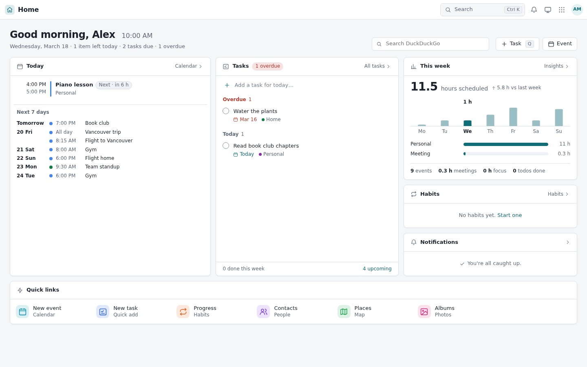
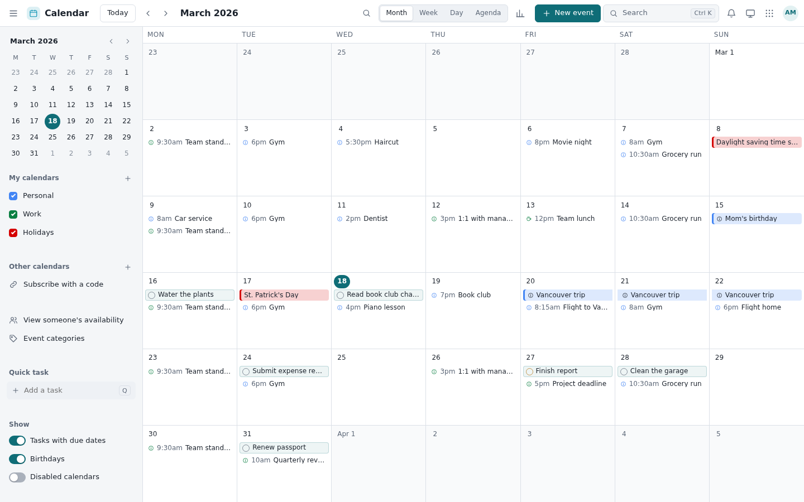
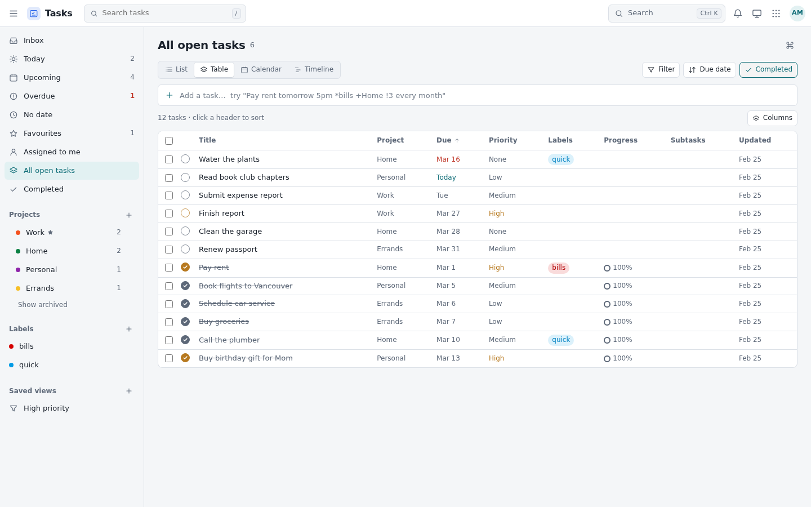
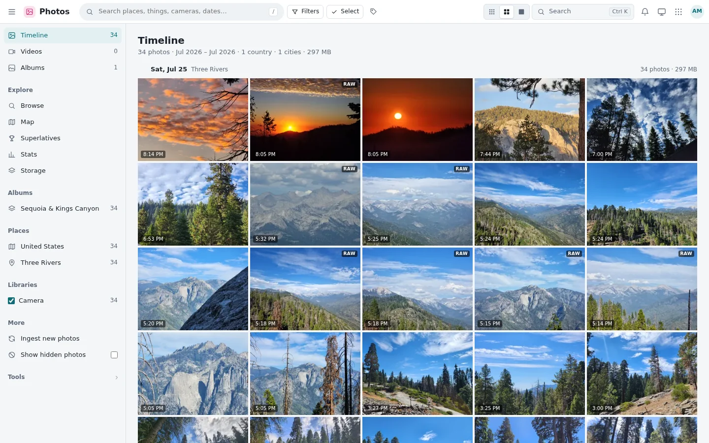
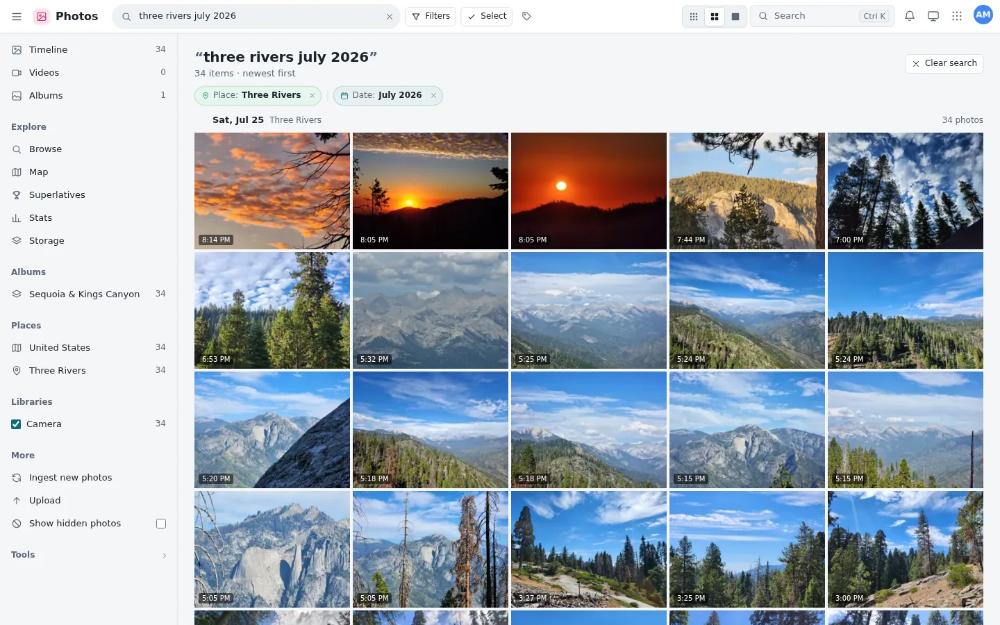
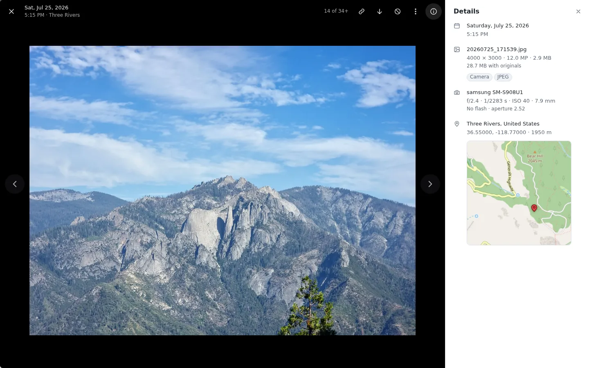
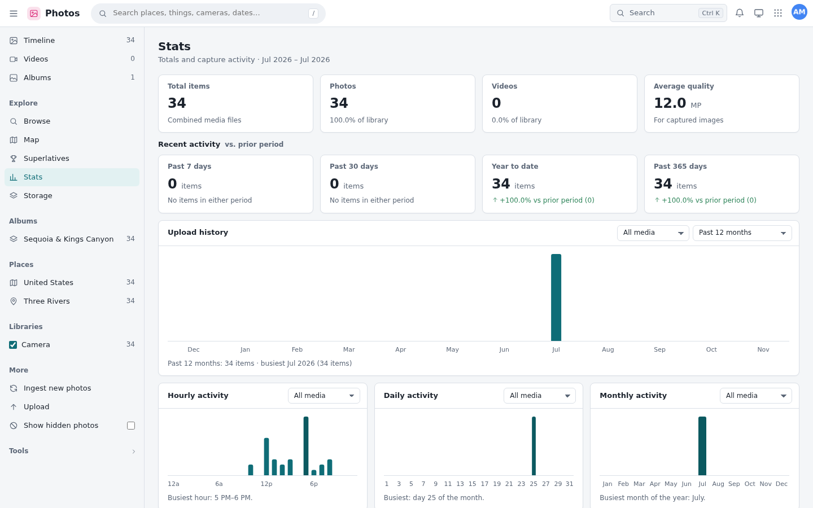
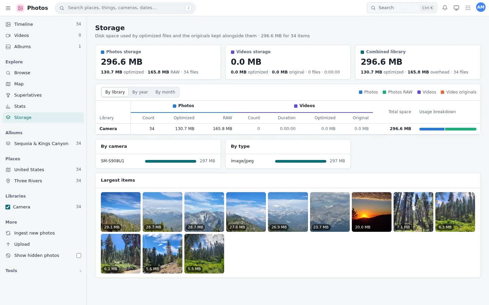
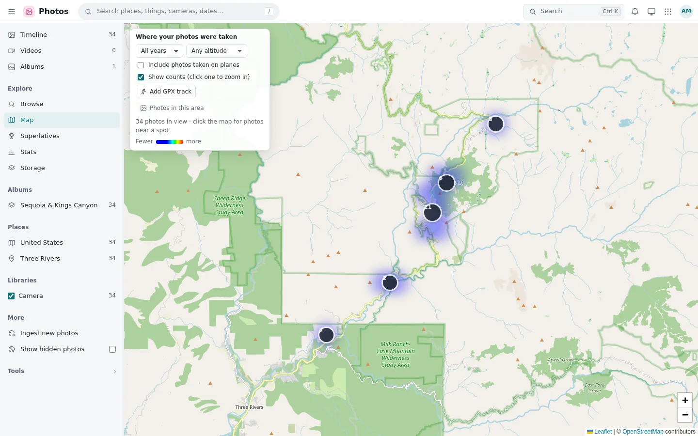

# Screenshots

The current AVNet Superapp, the React app served at `/`. Every screenshot shows fictional data: a March 2026 calendar and task list for a made-up user, Alex Morgan, and 34 landscape photos from one day in Sequoia National Park. They were rendered from the app's own build with no backend (static files, with the API answered by mocked data), at 1440 × 900 in light mode.

## Home

Today's agenda and the next 7 days, today's and overdue tasks, a "This week" hours chart from Calendar Insights, habits, notifications and quick links to every app.

## Calendar

Month view with a mini month, "My calendars" and "Other calendars", and tasks with due dates on the grid. Week, day and agenda views, Insights and a second time zone are a click away.

## Tasks

Smart views, projects, labels and saved views in the sidebar; here as a table of all tasks, completed ones included. List, board, calendar and timeline layouts use the same data.

## Photos

**Timeline:** a justified grid with a summary line, day headers with places and size, and the time each photo was taken.

**Smart search:** free text read into removable terms. "three rivers july 2026" becomes Place: Three Rivers and Date: July 2026.

**Viewer:** the original file, with a Details panel for date, file, camera, place and a mini-map.

<table>
<tr>
<td width="33%" valign="top"> <b>Stats:</b> totals, recent activity against the prior period, upload history and activity charts.</td>
<td width="33%" valign="top"> <b>Storage:</b> totals, a by-library table, by camera and type, and the largest items.</td>
<td width="33%" valign="top"> <b>Map:</b> a heatmap with count bubbles over OpenStreetMap.</td>
</tr>
</table>

## Through the years

Each app has changed a lot since 2020. [Appendix F of the history](HISTORY.md#appendix-f-screenshots-through-the-years) shows every major version, rendered from its own commit with the same fictional data:

- [Calendar](HISTORY.md#calendar), from Docket, the 2020 school scheduler it grew out of, to today's React calendar;
- [Tasks](HISTORY.md#tasks), a page of its own only since November 2026;
- [Home](HISTORY.md#home), from a giant clock with link cards in 2021 to today's dashboard;
- [Photos](HISTORY.md#photos), from PikPic, the Hack the North 2021 project that was the original Photos, to smart search.
